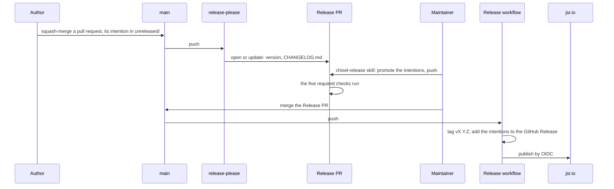

# How chisel is released

Chisel is published to JSR as `@lonestone/chisel`. Nobody publishes it by
hand. Every release goes through a **Release PR**: a pull request that
release-please keeps open on `main`, and that a human merges when the
release is ready. Merging it is the only act that ships. CI then tags the
commit, writes the GitHub Release and publishes the package.

This page explains the whole system: what each piece does, the order they
run in, and what to do when one of them fails. How to write a change and its
intention is in [CONTRIBUTING.md](CONTRIBUTING.md). The repository settings
the system needs are in
[scripts/github-repo-settings.md](scripts/github-repo-settings.md).

## The life of a release

1. **A change lands on `main`.** Its pull request carries its intention
   under `socle/intentions/unreleased/` when the change touches `socle/`.
   It is squash-merged, so its title becomes the commit on `main`.
2. **release-please updates the Release PR.** On every push to `main`, it
   reads the commits since the last release and opens or updates a pull
   request titled `chore(release): release X.Y.Z`, labelled
   `autorelease: pending`. That pull request bumps the version in
   `deno.json` and `.release-please-manifest.json`, and writes
   `CHANGELOG.md`.
3. **A maintainer prepares it**, with the `chisel-release` skill, just
   before merging. The skill moves each intention from `unreleased/` to the
   release's folder, checks it against the diff, runs the gates and pushes.
4. **A human merges it.** Green checks only say the release is coherent.
   The decision to ship is the merge.
5. **CI ships it.** The same workflow run tags `vX.Y.Z`, appends the
   release's intentions to the GitHub Release, checks once more that the tag
   matches `deno.json` and that no intention is left unreleased, and
   publishes to JSR.

## How the version is chosen

release-please reads the type of each commit on `main` since the last tag:

| Commits since the last release | Next version, while chisel is 0.x |
|---|---|
| at least one `feat` | minor (`0.2.4` → `0.3.0`) |
| a breaking change (`type(scope)!:`) | minor too: `bump-minor-pre-major` |
| otherwise, a `fix`, `perf`, `revert`, `docs` or `refactor` | patch (`0.2.4` → `0.2.5`) |
| only `chore`, `ci`, `test`, `style`, `build` | no Release PR |

That is why every commit is conventional, and why the pull request title is
linted: on `main`, the title is the commit. The `changelog-sections` of
`release-please-config.json` decide the last two rows: a type its section
hides from `CHANGELOG.md` releases nothing on its own.

## Intentions through a release

An intention is written in the pull request of its change, as
`unreleased/<slug>.md`, with the id `unreleased/<slug>`. At the release,
`deno task promote-intentions <version>` moves it to
`<version>/NN-<slug>.md`, numbered after the files already there, and
rewrites its id to `<version>/<slug>`, and updates `src/socle-files.ts`.
It refuses, moving nothing, when the version is not the one in `deno.json`
or when `unreleased/` is empty. A repo that already recorded the
`unreleased/` id is not asked again: its record counts for the promoted one.

The promotion happens last, on the Release PR, because release-please
rewrites that branch on every push to `main`. If the branch was rewritten
after a promotion, promote again.

## The pieces

| Piece | What it does |
|---|---|
| `release-please-config.json`, `.release-please-manifest.json` | How release-please versions chisel: `simple` type, `v` tags, version mirrored into `deno.json`, history read from the commit before v2. The manifest holds the last released version. |
| `.github/workflows/release.yml` | On a push to `main`: release-please, then, when a release was created, the notes and the publish. Run by hand with a tag, it retries the publish only. |
| `.github/workflows/ci.yml` | "Check and test": `deno task check` and `deno task test`. |
| `.github/workflows/pr-lint.yml` | "PR title and description" and "Commits": every commit and the squash title are conventional. |
| `.github/workflows/intention-gate.yml` | "Intention gate": a pull request that changes `socle/` adds an intention, or carries the `no-intention` label. |
| `.github/workflows/intention-promote.yml` | "Intention promote": on the Release PR only, every intention is promoted. Its failure message is the command to run. |
| `scripts/release-check.ts` | Every rule the workflows apply, one subcommand each: `gate`, `promoted`, `publish`, `notes`. |
| `scripts/promote-intentions.ts` | The promotion of step 3. |
| `scripts/commit-lint.ts` | The commit rule, used by the commit-msg hook (`deno task hooks`) and by "Commits". |
| `.agents/skills/chisel-release/SKILL.md` | The maintainer's procedure for step 3. |
| `scripts/configure-github-repo.sh` | Squash merge only, the `no-intention` label, Actions allowed to open pull requests, `main` protected by the five checks. |

The five checks are required on `main`. Each of them passes without running
when it does not apply, so every pull request reports all five.

## Who does what

- **The author of a change** writes its intention and a conventional
  title. Nothing else about the release.
- **The maintainer** prepares the Release PR with the skill, and says when
  it is ready.
- **A human** merges the Release PR, from GitHub's interface, as
  themselves. A merge by a workflow token would not start the run that tags
  and publishes.
- **CI** tags, writes the release notes and publishes. Never a person.

## When something goes wrong

- **The Release PR shows no checks.** release-please pushes with
  `GITHUB_TOKEN`, which starts no workflow. The checks run once a
  maintainer pushes to its branch. The skill always pushes: the promotion,
  or an empty commit when there is nothing to promote.
- **"Intention promote" fails.** An intention is still under `unreleased/`.
  Run the command its message gives, commit and push.
- **The publish failed after the tag was created.** Run the `Release`
  workflow by hand (**Run workflow**), with the tag. It publishes that tag
  without tagging again.
- **The publish refuses the tag.** The tag and `deno.json` disagree, or an
  intention was left unreleased. Nothing was published. Fix it on `main`
  through a new pull request: the next Release PR carries the fix.
- **A required check is renamed.** Every pull request waits for the old
  name. Update the list in `scripts/configure-github-repo.sh` and in
  `scripts/github-repo-settings.md`, then change the protection in the
  repository settings.
