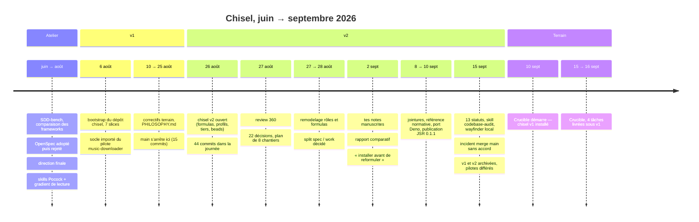
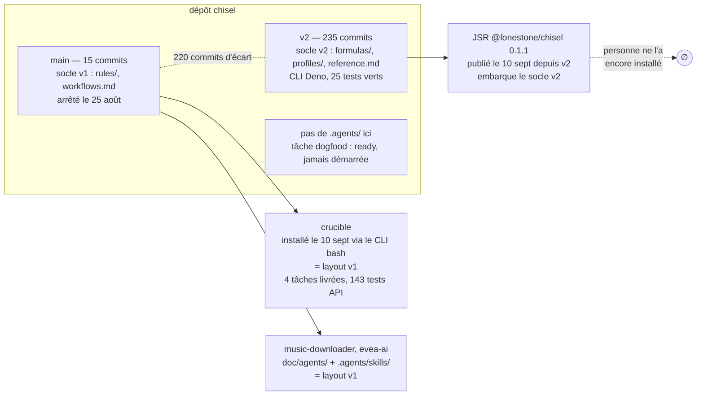
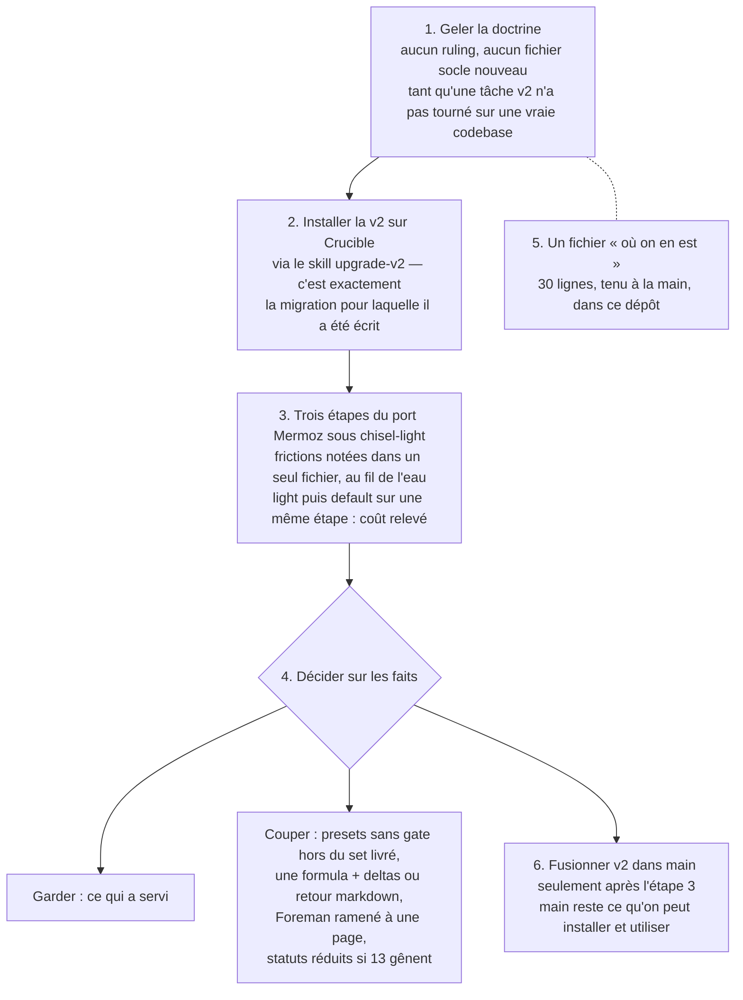
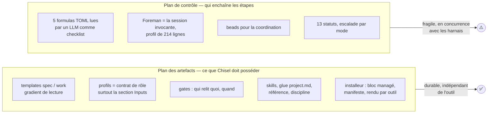

# Chisel — bilan et avis (2026-09-16)

Réponse aux six pages de notes manuscrites de l'Owner (transcrites dans
`review-360-notes.md`, relues contre les photos ce jour). Sources : la branche
`v2` de ce dépôt au commit 1942d38, la branche `main`, le rapport comparatif du
2 septembre (`review-360-analysis.md`), le registre de décisions, et l'état
réel des dépôts voisins `crucible`, `music-downloader` et `evea-ai`.

Convention d'écriture : aucune décision n'est citée par son code ; chaque
chose est nommée par ce qu'elle est.

---

## 1. Le verdict en une page

**Ce qui marche, c'est ce que tu as dessiné page 1 : neuf étapes, deux gates
humaines, un thread pour la spec et un pour l'implémentation.** Ça existe, ça
s'appelle chisel v1, et c'est ce qui tourne aujourd'hui en production : sur
Crucible (installé le 10 septembre, quatre tâches livrées en six jours, suite
API à 143 tests) et sur les deux pilotes music-downloader et evea-ai.

**Chisel v2 n'a jamais été utilisé par personne, pas même par chisel.** Six
semaines, 220 commits au-dessus de `main`, cinq formulas, cinq profils, treize
statuts, un registre de 1 285 lignes de décisions, et aucun dépôt ne l'a
installé. Ce dépôt n'a pas de `.agents/`. Crucible tourne en v1. La migration
des pilotes est différée par toi le 15 septembre avec la phrase qui résume
tout : « je suis pas sûr de ce qu'on a fait avec chisel v2 ».

**Le problème n'est pas la direction, c'est la méthode de construction.** La v2
a été bâtie par la méthode sur elle-même, sans consommateur extérieur. Un agent
à qui l'on demande des règles écrit des règles ; à qui l'on demande de
consigner les décisions en consigne 1 285 lignes. Rien ne freinait. Le résultat
est exactement ce que tu décris page 3 : des codes partout, du gibberish, un
reste-à-faire illisible. Et je le dis sans détour : c'est le système, moi et
mes prédécesseurs dans ce dépôt, qui a produit ça.

**La v2 contient pourtant des pièces solides**, à garder : le CLI Deno testé et
publié, la séparation spec / document de travail, la référence unique
(glossaire, zones, tiers), les profils comme contrat de spawn, l'étape qui
réconcilie un `AGENTS.md` écrit à la main avec le bloc installé.

**Ce que je recommande** : geler la doctrine, installer la v2 sur Crucible
(c'est le terrain de dogfood idéal, il existe et tu y travailles), faire tourner
trois étapes du port sous le preset light, et décider ensuite ce qu'on coupe
sur des faits observés. Détail en §8.

---

## 2. Ce qu'on a fait — la chronologie

Treize jours de commits en tout, par rafales : 44 commits le 26 août, 38 le
15 septembre. Le travail se fait en sessions intenses, chacune produisant un
chantier complet avec sa spec, son document de travail, sa revue et son
addendum au registre.

---

## 3. Où vivent les choses aujourd'hui

Point à connaître : le paquet publié embarque la v2, mais Crucible a été
installé le même jour, une heure avant la publication, avec l'ancien CLI bash.
Son manifeste liste `rules/task-creation.md` et `workflows.md`, la forme v1.

---

## 4. Les chiffres qui comptent

| Mesure | Valeur | Ce que ça dit |
|---|---|---|
| Doctrine du socle (discipline, méthodo, référence, formulas, profils, templates) | 3 242 lignes | Le produit |
| Skills livrés | 3 415 lignes, 17 skills dont 14 forkés de Pocock | Le moteur |
| Code du CLI + tests | 1 596 + 1 474 lignes, 25 tests verts, lint propre | La seule partie prouvée mécaniquement |
| `project-management/` de ce dépôt | 30 686 lignes de markdown | Près de 5 lignes de paperasse par ligne de produit |
| Registre de décisions | 1 285 lignes, 14 addenda | Personne ne le relit en entier |
| Une formula | 195 à 254 lignes, ×5 presque identiques | Cinq copies d'une même chose |
| Profil Foreman | 214 lignes | Pour un rôle que l'humain tient en default |
| Dépôts qui utilisent v2 | 0 | Le chiffre qui décide de tout le reste |

---

## 5. Le rapport du 2 septembre : suivi ou pas ?

Le rapport comparatif du 2 septembre donnait six priorités. Voici ce qui en a
été fait.

| Priorité recommandée le 2 sept | État le 16 sept |
|---|---|
| 1. Fermer le split spec / work | ✅ Fait le 8 septembre |
| 2. Installer le socle ici, écrire une vue « où on en est », puis une vraie tâche sous le socle en light, doctrine gelée | ❌ Pas fait. Toujours pas de `.agents/`, toujours pas de fichier d'état. La tâche dogfood est `ready` depuis le 15 |
| 3. Réduire les porteurs (référence extraite, une formula + deltas, doctrine des modes sans gate dans une seule maison, registre par titres, limite de longueur) | 🔧 Partiel. La référence est extraite, la règle « un code ne voyage jamais seul » est écrite. Les cinq formulas restent cinq. Le registre reste indexé par codes. Le Foreman a grossi |
| 4. Une commande pour lancer une formula par script (ce que Crucible attend) | ❌ Pas fait |
| 5. Le use case Plane, brique par brique | ❌ Pas commencé |
| 6. Ensuite : port Deno, audit des skills, wayfinder, UC2 | ✅ Port Deno fait, et fait proprement. Wayfinder local fait |

Ce qui a été fait à la place : le modèle de statuts à treize valeurs, le skill
codebase-audit, le wayfinder local. Trois ajouts de doctrine et d'outillage,
zéro utilisateur. Et un incident : le 15 septembre le Foreman a fusionné dans
`main` sur un « go » donné pour autre chose ; tu as dû rollback. C'est le
symptôme le plus concret du poids de la machine : plus de rôles, plus
d'occasions de mal lire un accord.

**Le pattern à casser est celui-là**, plus qu'aucun fichier en particulier : la
doctrine continue de bouger tant que personne ne l'utilise, et personne ne
l'utilise parce qu'elle bouge.

---

## 6. Tes douze questions, réponses courtes

| # | Ta question | Réponse |
|---|---|---|
| Q1 | Faire vivre un mode « factory » dans le même repo : bonne idée ? | Pas encore. Ton intuition page 3 est juste : la v2 a payé le prix de la factory (cinq presets, Foreman, TOML, beads) pour une factory qui n'a pas posé sa première brique. Un seul dépôt, mais les pièces sans gate humaine sortent du set installé par défaut jusqu'à ce que UC1 ait un lanceur |
| Q2 | Rôles et workflows « code based » : nécessaires ? Pourquoi ? | Les profils : oui, courts, parce que Claude Code et Codex les consomment comme définitions d'agents et que le CLI les rend. Les formulas TOML : non prouvé. Rien ne les exécute ; en v1 une page markdown faisait le même travail. À trancher quand un lanceur existera, pas avant |
| Q3 | Séparer en deux versions de Chisel ? | Non. Un produit, un set installé par défaut (light), et un dossier opt-in pour les pièces factory. Deux dépôts pour une personne, c'est deux fois la maintenance |
| Q4 | Que récupérer de la V2 ? | Le CLI Deno et ses tests ; le split spec / work ; `reference.md` ; les quatre profils réduits ; l'idée des statuts `waiting-*` (où suis-je attendu) ; le skill codebase-audit ; l'étape qui réconcilie `AGENTS.md`. Voir §7 |
| Q5 | Comment simplifier ? | Geler d'abord. Puis : une formula et une table de deltas ; le Foreman ramené à une page ; les trois presets sans gate hors du set livré ; un fichier « où on en est » de 30 lignes ; le registre indexé par titres ; une forme imposée aux entrées de journal. Et une règle de conduite : plus aucune décision de doctrine sans un fait observé en session sur une vraie codebase |
| Q6 | Un canal de com entre agents en mode factory ? | Pas maintenant. Un pipeline séquentiel se passe des fichiers via le thread. À rouvrir le jour où deux agents tournent en parallèle sur le même chantier |
| Q7 | Où stocker spec et doc générée : beads, repo, Plane ? | Dans le repo, en markdown. Le tracker (Plane ou beads) porte un pointeur et un statut, jamais le contenu. C'est déjà la convention écrite, elle est bonne |
| Q8 | Review humaine d'une spec en beads ? | La spec n'est pas dans beads. Elle est un fichier : la review humaine est une PR, ou un commentaire Plane qui pointe le fichier |
| Q9 | Qui tranche quand le maçon est bloqué sans humain ? | Personne, et c'est correct aujourd'hui : il bloque et laisse un rapport écrit. « Appeler un agent plus frontier » est le territoire de UC2 ; ne pas le construire avant |
| Q10 | Grill-me async : skill différent ? supportable ? | Oui, un skill différent : toutes les questions d'un coup, chacune avec sa réponse recommandée et un délai par défaut au bout duquel la recommandation s'applique. C'est ce qui le rend supportable |
| Q11 | Sous-agents : coût en tokens ? | Non mesuré, nulle part. Crucible est l'instrument : la même étape du port en light puis en default, coût et durée relevés. Première mesure utile avant tout benchmark |
| Q12 | Sandbox d'exécution (VM Daytona) ? | Nécessaire seulement pour un Mason sans humain. Pas avant UC1 |

---

## 7. Mon avis honnête

1. **La valeur de Chisel est dans le flow de la page 1, et ce flow est en
   production.** Quatre tâches en six jours sur Crucible, un pilote qui livre,
   des specs relues. Rien de ce qui compte n'est cassé.

2. **La v2 a été une entreprise de doctrine, pas de produit.** Elle a résolu
   pour de vrai une des trois lacunes de la v1 que tu listes page 3, « pas
   clair ce qu'il fallait relire », par le split spec / work. Les deux autres,
   « pas de rôle » et « workflows en prose », étaient des prérequis de factory,
   pas des douleurs d'utilisateur. On a construit pour un usage qui n'existe
   pas encore.

3. **Le rapport du 2 septembre avait raison et n'a pas été suivi sur ce qui
   comptait.** L'installation et le dogfood étaient la priorité 2 ; à la place,
   trois chantiers de doctrine de plus. Ce n'est pas une faute d'un fichier,
   c'est la dynamique du système : chaque session ferme un chantier en ouvrant
   un addendum, et l'addendum appelle un chantier.

4. **La verbosité n'est pas un problème v2.** Regarde le journal de Crucible
   sous v1 : chaque entrée fait 400 mots. C'est une habitude du modèle. Une
   règle d'écriture ne la corrige pas (la v2 en a trois, ça n'a rien changé) ;
   une forme imposée dans le template la corrige (« une entrée : cinq lignes et
   un lien vers la tâche »).

5. **Les codes sont produits par la machine qui les interdit.** Le registre est
   indexé par codes, la règle dit de ne pas les citer. Tant que l'index est en
   codes, les agents citeront des codes. Renommer les entrées par leur sens
   coûte une heure et règle la moitié de ton irritation.

6. **Ce que la v2 a de bon est réel et mérite d'être livré.** Le CLI Deno est
   la meilleure pièce du dépôt : testé, publié, il refuse une mise à jour sur
   un layout v1 en pointant le skill de migration. Le split spec / work, la
   référence unique, le pas 7 du questionnaire (« une seule voix dans
   `AGENTS.md` ») sont des améliorations qu'un utilisateur sentira.

7. **Le mot le plus important de tes notes est « désagréable ».** Une méthode
   que son auteur n'a plus envie d'utiliser est morte quelles que soient ses
   qualités. C'est ça qu'il faut traiter d'abord, et le seul remède est de la
   remettre au contact d'une codebase.

---

## 8. Ce que je recommande

Trois précisions.

- **Pourquoi Crucible et pas ce dépôt.** Chisel n'a pas de codebase : le
  dogfood ici ne testerait que la paperasse sur la paperasse, ce qui est
  précisément le piège des six dernières semaines. Crucible a une codebase, des
  tâches en cours, et toi dessus. Et la migration v1 → v2 y est un vrai test du
  skill `upgrade-v2`, qui n'a jamais tourné non plus.

- **Le fichier « où on en est ».** Ton « hyper dur de savoir où j'en suis »
  se règle sans doctrine : un fichier court, trois blocs (fait, en cours,
  reste), tenu à la main à chaque close. Le rapport du 2 septembre le
  demandait déjà.

- **Crucible et le benchmark.** Crucible, tel que sa note d'intention le dit,
  est le bac à sable ; l'outillage de mesure n'est pas commencé. La première
  brique utile est petite : un script qui lance une formula sur une tâche sans
  humain devant (le preset auto-light existe pour ça) et relève coût et durée.
  C'est aussi la première brique du lanceur de ton use case Plane. Même
  primitive, deux usages. Après l'étape 3 ci-dessus, pas avant.

---

## 9. Ce que je n'ai pas pu vérifier

- Le coût réel des sous-agents : aucune mesure n'existe, dans aucun dépôt.
- Si Cursor lit `AGENTS.md` seul de façon fiable : le test prévu depuis la v1
  n'a jamais été fait.
- Le ressenti d'un utilisateur autre que toi : Chisel n'a qu'un utilisateur, ce
  qui rend « désagréable » à la fois subjectif et décisif.

---

## 10. La v2 est-elle la bonne approche ? (ajout du même jour, sur demande)

Jugée non plus contre le rapport du 2 septembre, mais contre les trois choses
que tu veux en faire : un flow humain quotidien, efficace et pas cher ; une
voie vers un mode automatique piloté par Plane ; un banc de mesure (Crucible).

### La v2 est deux choses collées ensemble

**Le plan des artefacts est juste, et c'est la bonne approche.** La séparation
spec / document de travail répond à la seule douleur réelle de la v1. Le contrat
« un Mason reçoit des artefacts, jamais la conversation » est l'idée la plus
importante du dépôt : c'est elle qui rend une étape lançable par n'importe qui,
humain, sous-agent ou script, sur n'importe quel modèle. L'installeur qui
génère les définitions par outil au lieu de les référencer est exactement ce
que « compatible avec tout projet » veut dire. Rien de tout ça n'existait en v1.
Revenir en v1 serait une erreur.

**Le plan de contrôle est le mauvais pari, et c'est lui qui a produit le
poids.** Une formula TOML interprétée par une session LLM est l'orchestrateur
le plus faible possible : non déterministe, sans état entre les sessions, sans
boucle d'événements, sans reprise. Or c'est précisément ce que les harnais
livrent désormais nativement : Claude Code a des sous-agents définis en
fichiers, des hooks, un outil Workflow qui enchaîne des agents en script
déterministe, des routines planifiées, des sessions distantes ; Codex et
Cursor suivent ; Plane et Linear exposent des intégrations agents. Le
« Foreman qui spawne l'étape suivante, fraîche » sera un script de quarante
lignes dans l'outil, pas un profil de 214 lignes lu à chaque session. Les cinq
presets, la propriété des zones par preset, l'escalade par mode, les treize
statuts : tout ça existe pour faire tenir un runtime en prose. En mode humain
ce runtime, c'est toi et une checklist ; en mode usine, ce sera du code.

### Contre chacun de tes trois objectifs

| Objectif | La v2 telle qu'elle est | Ce qu'il faudrait |
|---|---|---|
| Flow humain quotidien | Squelette juste, poids faux : cinq spawns par tâche en default, chacun relisant discipline + référence + profil + spec avant d'agir. La v1 à deux threads est moins chère, et tu l'as éprouvé | Light comme défaut, le Foreman réduit à « ce que fait le propriétaire du fil à chaque étape » en une page, une seule formula |
| Mode automatique Plane | Les artefacts et les contrats y suffisent déjà. L'orchestration en prose ne tiendra pas : pas d'événement, pas d'état, pas de PR, pas de merge | Un plan de contrôle en code, hors du socle installé : un script qui écoute Plane, compose le brief depuis le profil, lance une session, écrit dehors. Chisel lui fournit `profil + brief`, rien de plus |
| Banc de mesure Crucible | Pour comparer des workflows il faut les lancer par programme. Rien dans la v2 n'est lançable sans un humain qui ouvre une session | La même brique : une commande qui imprime le brief d'un rôle pour une spec donnée. C'est la première chose à construire, et elle sert les deux derniers objectifs |

### Ce que ça change à la question « une ou deux versions »

Ni l'une ni l'autre. La coupure utile n'est pas v1 / v2 ni default / factory :
c'est artefacts / contrôle. Chisel possède les artefacts, les contrats, les
gates, la doctrine courte et l'installeur, et c'est un seul produit. Le
contrôle est mince, écrit dans l'outil du projet qui l'utilise, et différent
par mode : la main pour le quotidien, un script pour l'usine. Le socle ne
devrait plus contenir de runtime en prose du tout.

### Un dernier point, sur la fiabilité

La v2 mise sur des règles écrites pour obtenir des comportements : trois
règles d'écriture, une règle contre les codes, une règle de longueur
qualitative. Elles ne tiennent pas, et le journal de Crucible sous v1 le
montre autant que le registre sous v2. Ce qui tient, c'est la structure : un
template à forme fixe, un `chisel check` qui refuse une entrée de journal
trop longue ou un statut hors de l'échelle, un fichier généré plutôt qu'un
fichier relu. La v2 a le CLI pour ça et ne s'en sert que pour l'installation.
C'est là que le levier est, pas dans une douzième règle.

### Réponse courte

Oui pour le squelette, non pour le moteur. La v2 a le bon modèle d'artefacts
et le mauvais modèle d'exécution, et c'est le second qui l'a rendue
désagréable. Si je la dessinais aujourd'hui, j'en garderais environ les
deux tiers : tout ce qui décrit des documents et des contrats, rien de ce qui
décrit une machine.
