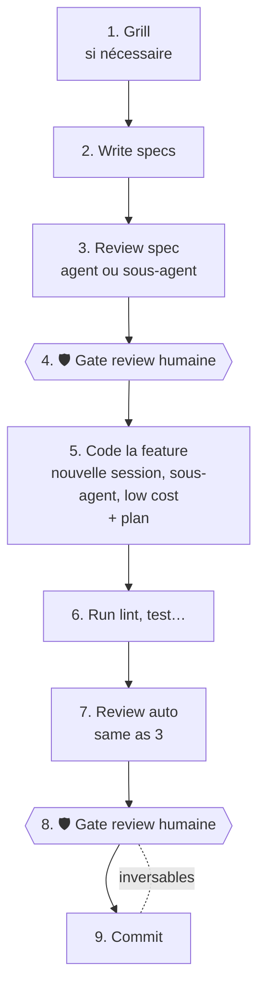
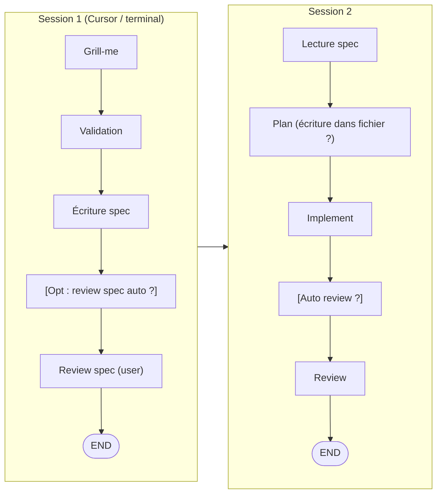
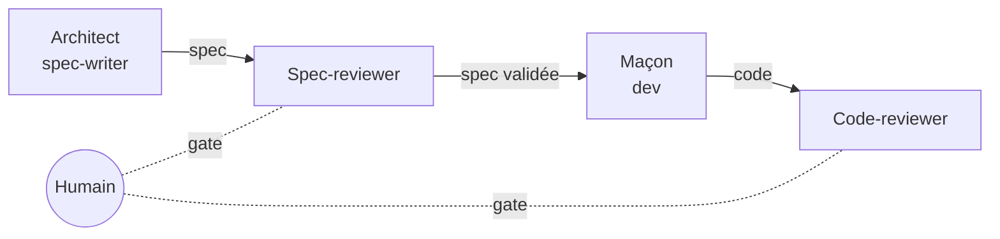
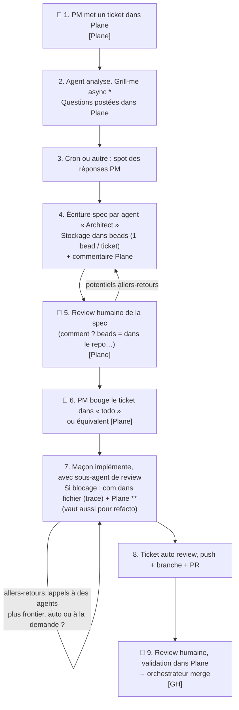
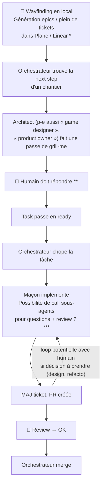

# Review 360 — notes manuscrites de l'Owner (transcription)

Transcription fidèle de six pages de notes manuscrites (cahier « Chisel »),
datées du 2026-09-02. Relue page par page contre les photos des six pages le
2026-09-16 : aucun écart de fond, transcription confirmée. Les schémas mermaid reprennent les diagrammes dessinés à
la main. Le texte entre crochets `[...]` est une note du transcripteur.

---

## 1. Cadre

> J'essaie de mixer plusieurs modes de travail dans 1 repo. Why not. Faut que
> Crucible arrive vite.

### Les grandes étapes sont toujours les mêmes

1. Grill (si nécessaire)
2. Write specs
3. Review spec (agent ou sous-agent)
4. 🛡 **Gate review humaine**
5. Code la feature (nouvelle session, sous-agent, low cost) → **+ plan**
6. Run lint, test…
7. Review auto (same as 3)
8. 🛡 **Gate review humaine**
9. Commit — _on peut inverser 8 et 9_

### Quelques notes

- **IDE ou terminal → human-in-the-loop.** Les agents peuvent échanger avec le
  dev, ça réduit les besoins de sync.
- **La traçabilité est indispensable.** On peut utiliser des artefacts ou faire
  autrement (db sqlite ? db git camp ?).
- **Sous-agent** = fonctionne bien, mais coût en tokens super élevé. À
  challenger.
- **Séparation forte : archi versus maçon** (modèles différents).
- **Efficacité éprouvée :** 1 thread archi pour la spec, 1 thread pour
  implémentation (+ opt. sous-agent review à la fin).

---

## 2. Le flow réel en deux sessions (Chisel v1)

> Grosso modo ça donnait ça, et ça fonctionnait très bien. Il n'y a ici aucune
> ref à de l'orchestration, l'humain fait encore beaucoup de choses sur le
> pouce.

### On peut déduire 4 rôles

1. **Spec-writer, aka Architect** — dont la responsabilité est de cadrer
   l'idée/problème et de rédiger une spec qui prend en compte la big picture.
2. **Dev, aka Maçon** — qui prend une spec, analyse par rapport à la codebase,
   planifie et finalise.

> ⚠ Généralement les 2 sont exécutés à la file. Au mieux on planifie quelques
> tâches en amont, mais jamais du « long horizon » (ça c'est ailleurs : Plane,
> Linear…).

3. et 4. **Spec-reviewer** et **Code-reviewer** — 2 agents de review auto qui
   ont un coût assez fort (mais pas mal de valeur).

> Cette méthodo, c'est **Chisel v1**, dans lequel on a 1 fichier par tâche qui
> réunit tout et pas vraiment d'agent / fiche rôle à proprement parler.
>
> Le but de Chisel reste aussi d'être **MAJ facilement** et d'être **compatible
> avec tout type de projet**.

---

## 3. Bilan de la V1

### Les lacunes de la V1

- Pas clair ce qu'il fallait relire ou pas.
- Pas de rôle, incompatible factory / automation.
- Workflows en prose et pas dans un format plus solide.

### Ses avantages

- Efficace.
- Simple.
- Plutôt token efficient.

### Questions

- Était-ce une bonne idée d'imaginer faire vivre une version « factory »
  compatible dans le même repo ?
- Rôles et workflow « code based » étaient-ils bien nécessaires ? Pourquoi ?

---

## 4. Ressenti sur la V2 (celle en cours)

> ⚠ Travailler avec cette V2 pour créer le nouveau Chisel est **désagréable**.
> Surtout sur du long horizon :

- Claude n'arrête pas de citer des codes (G15, SP1, ST-B…).
- Hyper dur de savoir où j'en suis, le RAF [reste à faire].
- Claude fait du « Claude gibberish »… ça rend la lecture galère, **et les
  passations entre agents aussi**.

Autres observations :

- Même si je visais un nombre de fichiers limité, il semble que la maintenance
  soit déjà une galère car il y a de nombreuses références partout… mauvaise
  archi ? problème de wording ?
- Les workflows beads sont un format toml ou json qui nous lie à beads même si
  on ne l'utilise pas.
- Peut-être que de la duplication vaut mieux que du générique chiant à maintenir
  ?
- Les agents / rôles, sauf le Foreman, ne devraient pas réellement connaître le
  contexte global : en tout cas pas de trace dans leur fichier markdown.
- Ce qui implique de les « prompter » correctement quand on les lance → plus
  complexe que dans la V1 avec ses quelques rôles.

### Questions ouvertes

- Serait-il possible de séparer en 2 versions de Chisel ? Souhaitable ?
- Que récupérer de la V2 ?
- Comment simplifier ?
- En mode factory, même si les beads permettent la sync, j'ai l'impression qu'il
  manque un canal de com entre agents (cf. JMail dans la roue de Jeffrey
  Emanuel).

---

## 5. Use case : mode automatique avec Plane

Légende : 👤 = étape humaine · `[Plane]` / `[GH]` = outil où vit l'étape.

Notes en marge :

- `*` Nécessite probablement un skill différent ?
- `**` Le maçon n'a pas de chef à appeler pour trancher ici.

> Finalement ici les agents parlent peu entre eux, le workflow est découpé en
> plusieurs parties (spec, impl…) contrairement à nos flows actuels. La
> coordination / orchestration se fait avec un agent global.

---

## 6. Use case : version encore plus automatique

> Ça en soi c'est un challenge.

Notes en marge :

- `*` Ou beads ? Et la doc générée (md), on la stocke où ?
- `**` Ça peut être chiant et frustrant de faire ça en async. Le top serait de
  pouvoir le faire de façon dynamique, et que les conclusions soient conservées
  (Plane ?).
- `***` VM Daytona ?

---

## Synthèse des questions ouvertes (extraites des six pages)

| #   | Question                                                           | Page |
| --- | ------------------------------------------------------------------ | ---- |
| Q1  | Faire vivre un mode « factory » dans le même repo : bonne idée ?   | 3    |
| Q2  | Rôles et workflows « code based » : nécessaires ? Pourquoi ?       | 3    |
| Q3  | Séparer en 2 versions de Chisel : possible ? souhaitable ?         | 4    |
| Q4  | Que récupérer de la V2 ?                                           | 4    |
| Q5  | Comment simplifier ?                                               | 4    |
| Q6  | Faut-il un canal de com entre agents en mode factory ?             | 4    |
| Q7  | Où stocker la spec et la doc générée : beads, repo, Plane ?        | 5, 6 |
| Q8  | Comment faire une review humaine d'une spec stockée en beads ?     | 5    |
| Q9  | Qui tranche quand le maçon est bloqué sans humain ?                | 5    |
| Q10 | Grill-me async : skill différent ? comment le rendre supportable ? | 5, 6 |
| Q11 | Sous-agents : coût en tokens à challenger                          | 1    |
| Q12 | Sandbox d'exécution (VM Daytona) ?                                 | 6    |
