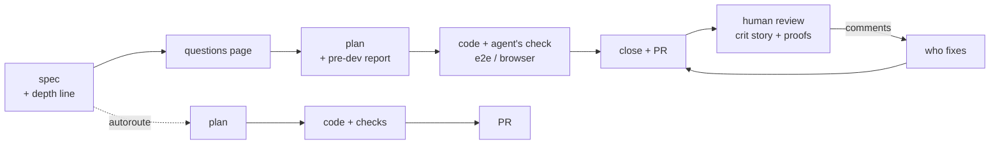

# Human review: a step of its own, with crit, visual proof and questions off the chat

**Status:** draft — waits on the Owner's answers to the open questions below; no Mason before them

---

> 🧑 **REVIEW CAREFULLY** — human decision surface. Read it all before code.

## Context

Chisel takes a task from intent to a pull request, then stops. Nothing in
`socle/agents/workflow.md` says how the human reviews that pull request, with
what tool, at what depth, or with which proofs. Today it lives outside
Chisel: in the Harness (the `crit` skills, Pierrick's story guide, the
`crit-review` script) and in a few projects' own rules (music-downloader's
"a Playwright spec for every UI path", its `review-videos` skill).

Two more pains sit before the code: questions asked in the chat (no visual
proposal, no diagram, not asynchronous), and a spec that has to be found on
disk instead of being read in a browser.

Source: the analysis page « Chisel, relecture en deux temps » (vault,
`23.17 Outillage/artefacts/2026-11-19`) and Pierrick's answers to it on
2026-11-19, quoted below.

## Scope

**Included:**
- A human-review step in `workflow.md`, with crit as the tool, shipped by
  Chisel as a skill that points to crit (never a copy of crit).
- A per-project review depth, and a lane without the human-only stops (the
  « autoroute »).
- Visual proof when a screen is touched, and the agent's own check of it.
- Questions to the human and the pre-development report as pages, not chat.
- Who fixes the review's comments, and the Mason's resume summary.
- An intention for every change under `socle/`.

**Not Included:**
- Our own review app (task `relecture-proto`, running in parallel) and any
  fork of crit.
- Reworking the crit prologue prompt: done « petit à petit », elsewhere.
- What serves a page, opens a herdr tab or wakes an agent: that is the
  Harness's (the shared page tool under way at Dédale).

## The decisions

Each is marked **Pierrick** (quoted, settled), **proposed** (mine, waits on
his yes) or **open** (a question below).

1. **crit ships with Chisel** — Pierrick: « ha Chisel n'embarque donc pas
   Crit ? Je pense que je vais l'ajouter. Moins modulaire, mais ajd le but
   c'est d'aller vite. » then « fais le ».
2. **A human-review step in the workflow** — Pierrick (question 4 of the
   analysis): « a. Mais c'est là où Chisel devrait certainement avoir un mode
   "autoroute" -> avec les checks auto mais sans toutes les étapes dédiées à
   l'humain uniquement ».
3. **The depth is the project's** — Pierrick (question 5): the project
   declares `human review: full | strategic`, plus the autoroute; « la
   relecture humaine devient moins prioritaire en fonction des projets ».
4. **No questions inside a crit review** — Pierrick, 11-09: « Les questions
   dans un Crit, c'est non ». A question goes to the questions page.
5. **A touched screen has a proof** — Pierrick (questions 6 and 7): at least
   a screenshot, and a before → after comparison when the screen existed.
   For the agent's own check, not shown to the human: a recorded Playwright
   e2e test, or at least a check in the browser or with Playwright.
6. **Questions and the pre-development report are pages, in Chisel** —
   Pierrick (question 8): « Pour moi c'est dans Chisel. Chisel c'est la
   procédure de travail sur un sujet. C'est applicable aux agents non dev
   aussi… » A page holds the thread; after the answers, an HTML report of
   what will be done, « une sorte de .spec mais chargé dans le browser ». He
   stays in herdr, the links always at hand.
7. **Step placement** — proposed: step 8, *Human review*, after the close
   and the pull request; it reviews the pull request's diff (`crit --pr`, or
   the branch diff without a remote). One task, one pull request, one human
   review (11-09).
8. **The `chisel-crit` skill** — proposed: a short skill that says where
   crit is, how to install it (`crit install <agent>`), when to call it, and
   the loop (background, `approved`, reply to each comment). The story guide
   ships as a project file, `.crit/prompts/on_story_generate.md`, placed by
   `chisel-setup` and kept current by `chisel update`; Pierrick's global
   guide becomes a short default pointing to it.
9. **A §J · Review section in `project.md`** — proposed: the depth, the
   e2e command, the recording command, the screenshot command, and where the
   proofs are written. No command means no proof of that kind, said in the
   review.
10. **Visual proof as a Chisel skill** — proposed: `visual-proof`, the
    music-downloader `review-videos` skill made generic; the project gives
    the commands through §J, the skill writes the files and an index page.
    Serving that page is the Harness's.
11. **Who fixes the comments** — proposed (the 11-04 note): no spec decision
    changed and closed under an hour ago, the same Mason; over an hour, a
    fresh Mason; a spec decision changed, the Architect fixes the spec, then
    a fresh Mason.
12. **The Mason's resume summary** — proposed: at the close, the Mason adds
    to the work document a short summary (decisions, key files, pitfalls,
    commands that work), the input of whoever fixes the comments.
13. **What triggers each proof** — open, question 1.
14. **How the autoroute is chosen** — open, question 2.
15. **The pre-development report and the plan** — open, question 3.
16. **The Chisel / Harness line** — open, question 4.
17. **Where the human sees the proofs** — open, question 5.

## Open questions for Pierrick

1. **What triggers a proof?** (a) Path patterns in §J (`front: apps/web/**`
   and so on): a script reads the diff and lists the pieces due. (b) The
   Architect writes the depth in one line of the spec (« captures + e2e »,
   « stratégique seul »); the diff only adds a floor (a screen touched means
   captures), never removes. **I recommend (b)**: one line to read, no pattern
   list to maintain, and the diff still catches what the spec forgot. You
   answered « a me parait bien » to (a) after « pas forcément convaincu »:
   which one?
2. **How is the autoroute chosen?** Ruling G10 (28/08): « je ne veux pas
   d'interrupteur », the flow is chosen at each invocation. (a) The project
   declares it in §J, and a task may ask for more. (b) The Architect writes
   it in the spec, per task, the project giving the default. (c) You say it
   when you launch the task. **I recommend (b)**: it is per task, written,
   and visible in the review, not a hidden switch. In autoroute, the code
   review and the gates still run; the human stops (spec reading, plan
   reading, human review) are skipped, the pull request is still opened.
3. **Does the pre-development report reuse the review's template?** In plain
   words: the final review shows four things on one page (what changed, in a
   sentence; the files touched as a tree; the data model before → after; the
   flows as diagrams). The question is whether the Mason fills that same page
   *before* coding, from its plan, as the report you read before the code. If
   yes, the final review becomes « prévu → fait » side by side, and a gap
   shows at once. If no, the report is free-form and the review stands alone.
   **I recommend yes**, filled at the plan step, at the cost of a slightly
   longer plan.
4. **Where is the Chisel / Harness line?** Proposed rule: Chisel ships what
   works without the Harness (the step, the skills, the page templates as
   static HTML files the agent writes, the story guide); the Harness serves
   those files, opens the herdr tab, carries the answers back and wakes the
   agent. Outside the Harness, the agent opens the file and the human
   answers in the chat. Is that the line, and does the questions page wait
   for Dédale's shared tool?
5. **Where does the human see screenshots and videos?** (a) Inside the crit
   story, if crit renders images there (to verify). (b) A separate proof
   page linked from the story, served by the Harness. **I recommend (a) for
   screenshots, (b) for videos**, until verified.

## Acceptance Criteria

- [ ] **workflow-has-human-review** — `socle/agents/workflow.md` has a step
  named *Human review*, after the close, and its "Where the work stops"
  table lists it.
- [ ] **autoroute-written** — `workflow.md` names the autoroute, what it
  skips and what it keeps, in the form question 2 settles.
- [ ] **crit-skill-ships** — `socle/agents/skills/chisel-crit/SKILL.md`
  exists, is listed in `src/socle-files.ts`, and contains no copy of crit's
  own skills.
- [ ] **story-guide-placed** — `chisel-setup` on an empty repo produces
  `.crit/prompts/on_story_generate.md`, and crit uses it there (checked with
  `crit story --guide`).
- [ ] **project-review-section** — `socle/agents/project.md.tpl` and this
  repo's `.agents/project.md` have a §J · Review section.
- [ ] **visual-proof-skill** — `socle/agents/skills/visual-proof/SKILL.md`
  exists, reads its commands from §J, and names no command of one project.
- [ ] **questions-page-template** — a questions-page template and a
  pre-development report template ship in `socle/templates/`, each opening
  as a plain file without a server.
- [ ] **who-fixes-written** — `workflow.md` gives the rule of decision
  *who fixes the comments* and the Mason's resume summary.
- [ ] **intention-per-change** — every change under `socle/` has its
  intention in `socle/intentions/unreleased/`; the Intention gate passes.
- [ ] **suite-green** — `deno task check` and `deno task test` pass.

## Seams

- Seam: `workflow.md` — an agent following it reaches a human-review step,
  or skips it in autoroute, and knows who fixes the comments.
- Seam: `chisel-setup` / `chisel update` — an equipped repo has the story
  guide in `.crit/prompts/` and the §J section.
- Seam: the page templates — an agent writes a questions page or a report as
  a file a browser opens; the Harness may serve it, nothing requires it.

## Architecture

Chisel ships: the step text, the `chisel-crit` and `visual-proof` skills,
the story guide, the page templates, §J. The Harness ships: serving,
waking, the herdr tab, the `crit-review` script that listens on the tailnet.

---

> 🧑 **REVIEW IF RELEVANT** — decisions, testing, slicing.

## Implementation Decisions

- An external tool is never copied: the skill points to it, says how to
  install it and when to call it (the Harness rule on external skills).
- crit stays unforked: everything rides on the story and on pages; small
  additions go upstream (question 3 of the analysis).
- Content written for agents goes through `writing-for-agents`
  (`CONTRIBUTING.md`).
- Each slice adds its own intentions; the release promotes them.

## Testing Strategy

- `test/integrity.test.ts` catches a new socle file not listed.
- A test runs `chisel-setup`'s placement on an empty folder and checks the
  story guide and §J appear.
- A dry run on music-downloader (screens, e2e, recording) validates
  `visual-proof` before it ships; a dry run on a repo without front checks
  that no screen means no capture.

## Slices & Dependencies

Folder `20261119-1644-relecture-humaine/`:

1. **Human review with crit** (blocked by: none) — the step, `chisel-crit`,
   the story guide, §J with the depth only.
2. **Who fixes the comments** (blocked by: 1) — the rule and the Mason's
   resume summary.
3. **Autoroute** (blocked by: 1; question 2).
4. **Visual proof** (blocked by: 1; questions 1 and 5) — `visual-proof`,
   §J commands, the agent's own check.
5. **Questions page** (blocked by: none; question 4) — the template and the
   rule that questions leave the chat.
6. **Pre-development report** (blocked by: 1 and 5; question 3).

## Deliverables

- [ ] The six slices, each with its intention(s) and a passing gate.

## References

- Analysis page « Chisel, relecture en deux temps » (vault, 23.17
  Outillage, 2026-11-19): the four-part review folder and the nine
  questions this spec answers.
- `project-management/review-360-decisions.md`, rulings E4 and G10: the
  earlier light lane and the « no switch » rule question 2 has to honour.
- Vault notes « Chisel, reprise après la review humaine » and « Chisel, coût
  des Masons et relecture du plan » (2026-11-04): the source of decisions 11
  and 12.
- Vault note « Chisel, règles de travail et crit » (2026-11-09): the rules
  to bring from the Harness into Chisel, source of decision 8.
- music-downloader, `.claude/skills/review-videos/SKILL.md`: the skill that
  decision 10 makes generic.
- Apollon, `outils/formulaire.mjs`: a 31-line questions form, model for the
  served side of slice 5.

## Notes

- The crit project-prompt trust gate is unverified: slice 1 checks that a
  committed `.crit/prompts/` file is used without a manual trust step.
- `.crit/prompts/` sits outside `.agents/`: a new placement for
  `chisel-setup`, written in its `PLACEMENT.md`.

## Retrospective

_At the close._
