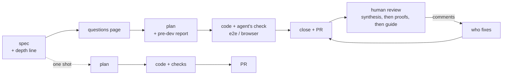

# Human review: a step of its own, with crit, visual proof and questions off the chat

**Status:** draft — split in two (21/11): group A (slices 01-04) approved
by Pierrick on 22/11 and ready; group B waits on the review tool

> **Two groups, two paces.** Pierrick (21/11): « P-e devrait ont split le
> chantier en 2 ? Les procédures / regles d'un coté qui ne necessitent pas
> forcément + d'outillage, et puis l'outil eensuite » ; « ça permettrait
> d'améliorer Chisel dès ajd ».
>
> - **A — the rules** (slices 01 to 04): the human-review step and its
>   strategic reading, who fixes the comments, the one shot, the visual
>   proof. They work with crit and plain files, need no new tool, and can
>   start now.
> - **B — the tool** (slices 05 and 06): the questions page and the
>   pre-development report. They wait on the tool the task
>   `relecture-analyse` prepares, and are not rewritten here. Decision 8
>   waits with them.

---

> 🧑 **REVIEW CAREFULLY** — human decision surface. Read it all before code.

## Context

Chisel takes a task from intent to a pull request, then stops. Nothing in
`socle/agents/workflow.md` says how the human reviews that pull request, with
what tool, at what depth, or with which proofs. Today it lives outside
Chisel: in the Harness (the `crit` skills, Pierrick's story guide, the
`crit-review` script) and in a few projects' own rules (music-downloader's
"a Playwright spec for every UI path", its `review-videos` skill).

Two more pains sit before the code: questions asked in the chat (no visual
proposal, no diagram, not asynchronous), and a spec that has to be found on
disk instead of being read in a browser.

Source: the analysis page « Chisel, relecture en deux temps » (vault,
`23.17 Outillage/artefacts/2026-11-19`) and Pierrick's answers to it on
2026-11-19, quoted below.

## Scope

**Included:**
- A human-review step in `workflow.md`, with crit as the tool for now,
  shipped by Chisel as a skill that points to crit (never a copy of crit).
- The review depth, written per task in the spec, and a lane whose only
  possible human stop is the final review (the « one shot », first called
  the autoroute).
- The strategic reading the human review opens on (decisions 21, 22).
- Visual proof when a screen is touched, and the agent's own check of it.
- Questions to the human, the pre-development report and the proofs as
  pages that Chisel serves itself, written here as **needs**: what each page
  shows and what it brings back.
- Who fixes the review's comments.
- An intention for every change under `socle/`.

**Not Included:**
- The design of the tool that serves Chisel's pages. Pierrick leans to an
  end-to-end review tool of our own (spec, questions, final review), built
  from pieces of diffmap, crit and Plannotator; its 360 analysis runs as the
  task `relecture-analyse`, and the prototype as `relecture-proto`. This
  spec states the needs and leaves the tool open.
- Any fork of crit.
- Reworking the crit prologue prompt: done « petit à petit », elsewhere.
- The Harness's own pages (the gods' questionnaires and the like), which
  head for Olympe.
- The queue, and anything that gathers several tasks, projects or
  worktrees: that is the Harness (decision 23). Chisel works one task at a
  time.

## The decisions

Each is marked **Pierrick** (quoted, settled), **proposed** (mine, waits
on his yes) or **open** (waits on something named).

1. **crit ships with Chisel** — Pierrick: « ha Chisel n'embarque donc pas
   Crit ? Je pense que je vais l'ajouter. Moins modulaire, mais ajd le but
   c'est d'aller vite. » then « fais le ». It stays the review tool until
   the tool of decision 16 replaces it.
2. **A human-review step in the workflow** — Pierrick (question 4 of the
   analysis): « a. Mais c'est là où Chisel devrait certainement avoir un mode
   "autoroute" -> avec les checks auto mais sans toutes les étapes dédiées à
   l'humain uniquement ».
3. **The review weighs less on some projects** — Pierrick (question 5): the
   project declares `human review: full | strategic` as its default, plus
   the autoroute; « la relecture humaine devient moins prioritaire en
   fonction des projets ».
4. **No questions inside a crit review** — Pierrick, 11-09: « Les questions
   dans un Crit, c'est non ». A question goes to the questions page.
5. **A touched screen has a proof** — Pierrick (questions 6 and 7): at least
   a screenshot, and a before → after comparison when the screen existed.
   For the agent's own check, not shown to the human: a recorded Playwright
   e2e test, or at least a check in the browser or with Playwright.
6. **Questions and the pre-development report are pages, in Chisel** —
   Pierrick (question 8): « Pour moi c'est dans Chisel. Chisel c'est la
   procédure de travail sur un sujet. C'est applicable aux agents non dev
   aussi… » A page holds the thread; after the answers, an HTML report of
   what will be done, « une sorte de .spec mais chargé dans le browser ». He
   stays in herdr, the links always at hand.
7. **Step placement** — Pierrick (19/11): « ok ». Step 8, *Human review*, after the close
   and the pull request; it reviews the pull request's diff (`crit --pr`, or
   the branch diff without a remote), against the pull request's base,
   not `main`, when pull requests are stacked. One task, one pull request, one human
   review (11-09).
8. **The review skills** — open, waits on the review tool. Pierrick
   (19/11): « attendons de settle sur un outil. Je pense que ça sera plus
   large comme skill, ça touche comment lancer la review / preview / spec,
   (p-e 3 skills ?) et ça pourrait appeler des sous skills pour
   l'outillage ». So: likely several skills, one per thing the human reads
   (launch the review, the preview, the spec), each calling a sub-skill for
   the tool behind it. My first draft, a single `chisel-crit` skill plus a
   story guide in `.crit/prompts/`, is set aside until the tool is chosen.
9. **A §J · Review section in `project.md`** — Pierrick (19/11): « ok ».
   The project's
   default depth, the e2e command, the recording command, the screenshot
   command, and where the proofs are written. No command means no proof of
   that kind, said in the review.
10. **Visual proof as a Chisel skill** — Pierrick (19/11): « yes ».
    `visual-proof`, the
    music-downloader `review-videos` skill made generic; the project gives
    the commands through §J, the skill writes the proof files. Showing them
    is the proofs page's job (decision 17).
11. **The Mason who did the work fixes the comments** — Pierrick (19/11):
    « toujours le macon qui a bossé ! Toujours. Le relancer couter aussi
    cher qu'un neuf : oui mais il a tout le bon contexte. » The task's Mason
    is woken to fix the review's comments, however long ago it closed; a
    fresh Mason only when its session is lost. When a comment changes a spec
    decision, the Architect fixes the spec first, then wakes the same Mason.
12. **No resume summary** — withdrawn. With decision 11 the same Mason
    fixes the comments with its own context; a summary would only serve a
    lost session. Pierrick (19/11): « du coup pas utile ? », then « go » on
    withdrawing it.
13. **The depth is a line of the spec, the diff a floor** — Pierrick
    (question 1, 19/11): « Spec + plancher ». The Architect writes the depth
    of the review in one line of the spec (for example « captures + e2e »,
    « stratégique seul »), starting from the project's default; the diff
    only adds a floor (a screen touched means captures), never removes.
    Path patterns in `project.md` are set aside. Pierrick adds: « On va
    tester ça et faudra monitor que l'agent demande pas toujours PLUS que le
    plancher, ce qui indiquerait un soucis. » So the close records, in the
    work document, the depth chosen and the floor the diff computed, and
    `retro` compares them: a task that asks more than the floor says why,
    and a run of them is a finding of the retro.
14. **When the autoroute is taken** — Pierrick (question 2, 19/11): « Taille
    de la tache ? Demande explicite ? », then « ok » to this wording. The
    Architect takes the autoroute when it judges the task small at step 2,
    or when the human asks for it explicitly; it writes the choice and its
    reason in one line of the spec, and the pull request repeats it. On the
    autoroute the code review and the gates still run and the pull request
    is still opened; the stops that only serve the human (reading the spec,
    reading the plan, the human review) are skipped. A human who asks for
    the full lane always gets it. There is no project switch (ruling G10).
    Amended on 21/11 by decision 18: the lane is named the one shot, the
    spec reading is still skipped, and the final review becomes optional.
15. **The report before and the review after share one form** — Pierrick
    (question 3, 19/11): « Intéressant. Pas sur que la vue en colonnes soient
    la bonne, mais l'idée l'est. » The Mason fills, at the plan step, the
    same parts the final review shows (what changes, in a sentence; the
    files touched; the data model before → after; the flows as diagrams),
    so the gap between planned and done shows at once. How the two are put
    side by side (columns or otherwise) is the review tool's, left open.
    Pierrick (on proposal 15, 19/11): « je pense que faut se concentrer sur
    la UX : à quoi on veut que ça ressemble. Avant de s'arreter sur le
    comment ». So the look of the report and of the review, shown as real
    variants, comes before any choice of form or tool.
16. **Chisel serves its own pages** — Pierrick (question 4, 19/11): « Non je
    porte que Chisel doit etre complètement autonome car des gens
    l'utilisent hors Harness ! Si on doit se monter un système de petit
    serveur à la crit, so be it ! Le Harness sa responsabilité pour les
    pages html c'est autre chose (questionnaires des dieux, etc.) et ça
    finirait plutot dans Olympe en fait ! » Chisel serves its pages and
    brings the answers back to the agent by itself; it relies neither on the
    Harness nor on Dédale's page tool. Which tool does it is left open (see
    Not Included).
17. **The proofs live in Chisel's pages** — Pierrick (question 5, 19/11):
    « je pense que mes réponses plus haut sont suffisantes ! » Screenshots,
    comparisons and videos are shown in a page Chisel serves, not in the
    crit story.

Decisions of 21/11, from Pierrick's notes on the page « Relecture, parcours
et fonctionnalités » (vault, `23.17 Outillage/artefacts/2026-11-19`):

18. **The one shot** — Pierrick (21/11): « Sur 7 8 9 j'interviens
    uniquement quand on est pas en mode ~ "one shot" ». Steps 7, 8 and 9 of
    the page are *review*, *fix the comments* and *merge*. The autoroute of
    decisions 2 and 14 takes this name. Then, answering question A2 of the
    21/11 report: « En oneshot je n'interviens que pour la review finale.
    Et encore. », and question A4 (does the one shot keep the spec
    reading?): « non ». So in one shot there is no spec reading; the only
    human stop left is the final review, and it may be skipped too: the
    Architect's one-shot line in the spec says whether it happens. The page
    said « il s'arrête à la spec »; Pierrick's answers replace it.
    *Proposed* for the merge: when the final review happens, Pierrick's
    approval there is his word for the merge; when it is skipped, the merge
    follows the merge and publish section of `project.md` (by default, his
    explicit word).
19. **Clarifying only when needed** — Pierrick (21/11): « A ne pas lancer
    si le besoin est archi clair » ; « Voir wayfinder si ça semble trop le
    bordel ». The interview of step 2 (`grilling`) is skipped when the need
    is clear, as `workflow.md` already says; when it gets tangled, the
    Architect switches to the `wayfinder` skill, a map of decision tickets.
20. **The spec stays a document** — Pierrick (21/11): « Le document ne doit
    pas disparaitre. Mais efectivement une vue web nous donne + de
    leviers. » The spec stays a file on disk; a web view comes on top of it
    with group B's tool, never in its place.
21. **The strategic reading comes first** — Pierrick (21/11): « Ici ça doit
    se lire aussi bie nqu'un bon article. Après avoir relu ça je devrais
    déjà voir un gros niveau de confiance, et le cas contraire je stop ici
    direct avec commentaires » ; « j'ai jamais demandé en 1 phrase. Surtout
    pas. C'est au max une page d'article » ; it carries « uniquement le plus
    critique notamment le schema de données mais aussi effectivement un
    grand changement d'archi ». The human review opens on a synthesis: what
    was done and why for the critical decisions, the data schema before →
    after and any large architecture change, one article page at most,
    never one sentence. If it gives him confidence, Pierrick goes down or
    approves; otherwise he stops there, with comments.
22. **Three readings** — from the same notes: the human review has three
    readings, highest first: the *strategic* one (the synthesis), the
    *proofs* (captures, before → after, video, command output) and the
    *reading guide* (the diff in chapters, the core first). The page's
    « System » card is merged into the strategic reading. The depth line of
    the spec (decision 13) says how far down the human goes: `strategic`
    stops at the synthesis, plus the proofs the floor demands; `full` goes
    to the guide.
23. **The queue is the Harness** — Pierrick (21/11), on the queue and
    anything that gathers several tasks: « ça c'est un peu mon harness
    actuel. Chisel c'est la couche juste en dessous, restons en là pour le
    moment ».
24. **The visual proof starts from the Harness's method** — Pierrick
    (21/11): « on a quelque chose dans le harness ». That is the script
    `captures.ts` (Playwright captures written to disk, a pixel comparison
    with a `.diff.png` map, and a text report: overflow, console errors,
    off-site requests) and the skill `verification-visuelle` (mechanical
    first; an agent never reads a capture in its own thread; a fresh
    sub-agent looks when needed and reports « non vérifié » for what it
    cannot see). Chisel must work without the Harness (decision 16), so
    slice 04 carries an equivalent inside Chisel. The code of `captures.ts`
    belongs to Olympe: a copy needs Olympe's agreement, asked by promethee.
    Pierrick (21/11, question A3): « a »: `captures.ts` is copied, in Node,
    once Olympe agrees; Chisel does not rewrite it. Olympe agreed the same
    night, with three things to make generic; slice 04 carries its words.
25. **The Mason writes the synthesis** — Pierrick (21/11, question A1):
    « faut un bon modele. Le mason pour test ». The task's Mason writes the
    synthesis of decision 21 at the close, because it holds the why, on a
    strong model (never the light tier). It is a trial: the retro of the
    first tasks says whether it holds.

## The pages, as needs

What each page must do, whatever tool serves it:

| Page | When | Shows | Brings back |
|---|---|---|---|
| Questions | step 2, and whenever an agent has a question for the human | each question with its options, a recommendation, a mockup or diagram when it helps | the answers, to the agent that asked, without the chat |
| Pre-development report | the plan step | what changes, the files touched, the data model before → after, the flows; the spec readable in the browser | the human's go or remarks |
| Proofs | the human-review step | screenshots, before → after, videos | nothing; linked from the review |

Each page is reachable by a link the agent gives the human, opens outside
the Harness, and is served by Chisel.

## Acceptance Criteria

- [ ] **workflow-has-human-review** — `socle/agents/workflow.md` has a step
  named *Human review*, after the close, and its "Where the work stops"
  table lists it.
- [ ] **autoroute-written** — `workflow.md` names the one shot, what it
  skips and what it keeps, and when the Architect takes it.
- [ ] **strategic-reading-written** (2026-11-21) — `workflow.md`'s human
  review opens on a synthesis of one article page at most, written from a
  template the socle ships, by the task's Mason at the close, and says
  the human may stop there.
- [ ] **capture-tool** (2026-11-21) — Chisel ships a capture command that
  writes captures, a before → after pixel comparison and a text report,
  with no Harness command involved.
- [ ] ~~**crit-skill-ships** — `socle/agents/skills/chisel-crit/SKILL.md`
  exists, is listed in `src/socle-files.ts`, and contains no copy of crit's
  own skills.~~
- [ ] ~~**story-guide-placed** — `chisel-setup` on an empty repo produces
  `.crit/prompts/on_story_generate.md`, and crit uses it there (checked with
  `crit story --guide`).~~
- [ ] **review-skills** (2026-11-19, replaces the two above; written once
  the tool is chosen) — the skills that launch the review, the preview and
  the spec ship in `socle/agents/skills/`, are listed in
  `src/socle-files.ts`, and copy no external tool's own skills.
- [ ] **project-review-section** — `socle/agents/project.md.tpl` and this
  repo's `.agents/project.md` have a §J · Review section.
- [ ] **visual-proof-skill** — `socle/agents/skills/visual-proof/SKILL.md`
  exists, reads its commands from §J, and names no command of one project.
- [ ] **depth-against-floor** — the work-document template records the
  depth chosen and the floor computed, and the `retro` skill compares them.
- [ ] **pages-without-harness** — the questions page and the report are
  served by Chisel, and an answer given on the questions page reaches the
  agent, with no Harness command involved.
- [ ] **who-fixes-written** — `workflow.md` gives the rule of decision
  *who fixes the comments*.
- [ ] **intention-per-change** — every change under `socle/` has its
  intention in `socle/intentions/unreleased/`; the Intention gate passes.
- [ ] **suite-green** — `deno task check` and `deno task test` pass.

## Seams

- Seam: `workflow.md` — an agent following it reaches a human-review step,
  or skips it in autoroute, and knows who fixes the comments.
- Seam: `chisel-setup` / `chisel update` — an equipped repo has the §J
  section, and, once the tool is chosen, what the review skills need.
- Seam: Chisel's pages — an agent hands the human a link; the human reads
  and answers in the browser; the answers come back to the agent. Outside
  this seam, the tool is free.

## Architecture

Chisel ships all of it: the step text, the review skills (decision 8,
open) and `visual-proof`, §J, and the pages with what serves
them. The Harness keeps only Pierrick's own setup (the `crit-review` script
that listens on the tailnet) and its own pages.

---

> 🧑 **REVIEW IF RELEVANT** — decisions, testing, slicing.

## Implementation Decisions

- An external tool is never copied: the skill points to it, says how to
  install it and when to call it (the Harness rule on external skills).
- crit stays unforked: small additions go upstream (question 3 of the
  analysis).
- Content written for agents goes through `writing-for-agents`
  (`CONTRIBUTING.md`).
- Each slice adds its own intentions; the release promotes them.

## Testing Strategy

- `test/integrity.test.ts` catches a new socle file not listed.
- A test runs `chisel-setup`'s placement on an empty folder and checks §J
  and the synthesis template appear.
- A dry run on music-downloader (screens, e2e, recording) validates
  `visual-proof` before it ships; a dry run on a repo without front checks
  that no screen means no capture.
- A test answers the questions page and reads the answer on the agent's
  side.

## Slices & Dependencies

Folder `20261119-1644-relecture-humaine/`:

Group A, the rules, starts now:

1. **Human review with crit** (blocked by: none) — the step and §J with the
   default depth; the strategic reading first, with the possible stop
   (decisions 21, 22); the review skills join once the tool is chosen.
2. **Who fixes the comments** (blocked by: 1) — the task's Mason, always;
   no resume summary (decision 12).
3. **One shot** (blocked by: 1) — no spec reading, the final review the
   only stop left and optional; Clarifier skipped when the need is clear,
   `wayfinder` when it tangles (decisions 18, 19).
4. **Visual proof** (blocked by: 1) — `visual-proof`, the capture command
   and the method of decision 24, §J commands, the agent's own check, the
   depth against the floor; the proofs are files until group B's tool
   shows them.

Group B, the tool, waits on `relecture-analyse`:

5. **Questions page** (blocked by: the review tool chosen after
   `relecture-analyse`, and the UX of decision 15) — Chisel serves the page and brings the answers
   back; questions leave the chat.
6. **Pre-development report** (blocked by: 1 and 5) — the shared form of
   decision 15, its look settled first, and the proofs page on the same
   tool.

## Deliverables

- [ ] The six slices, each with its intention(s) and a passing gate.

## References

- Analysis page « Chisel, relecture en deux temps » (vault, 23.17
  Outillage, 2026-11-19): the four-part review folder and the nine
  questions this spec answers.
- `project-management/review-360-decisions.md`, rulings E4 and G10: the
  earlier light lane and the « no switch » rule decision 14 honours.
- Vault notes « Chisel, reprise après la review humaine » and « Chisel, coût
  des Masons et relecture du plan » (2026-11-04): the source of the first
  drafts of decisions 11 and 12.
- Vault note « Chisel, règles de travail et crit » (2026-11-09): the rules
  to bring from the Harness into Chisel, source of the first draft of
  decision 8.
- music-downloader, `.claude/skills/review-videos/SKILL.md`: the skill that
  decision 10 makes generic.
- Apollon, `outils/formulaire.mjs`: a 31-line questions form, one input for
  the tool of slice 5.

## Notes

- If crit stays the tool: its project-prompt trust gate is unverified (is a
  committed `.crit/prompts/` file used without a manual trust step?), and
  `.crit/prompts/` sits outside `.agents/`, a new placement for
  `chisel-setup`.

## Retrospective

_At the close._
