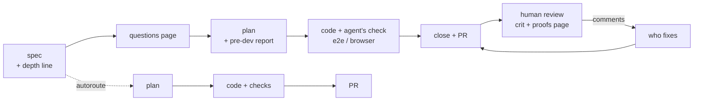

# Human review: a step of its own, with crit, visual proof and questions off the chat

**Status:** draft — every question answered on 2026-11-19; proposals 7 to 12 wait on the Owner's reading; no Mason before it

---

> 🧑 **REVIEW CAREFULLY** — human decision surface. Read it all before code.

## Context

Chisel takes a task from intent to a pull request, then stops. Nothing in
`socle/agents/workflow.md` says how the human reviews that pull request, with
what tool, at what depth, or with which proofs. Today it lives outside
Chisel: in the Harness (the `crit` skills, Pierrick's story guide, the
`crit-review` script) and in a few projects' own rules (music-downloader's
"a Playwright spec for every UI path", its `review-videos` skill).

Two more pains sit before the code: questions asked in the chat (no visual
proposal, no diagram, not asynchronous), and a spec that has to be found on
disk instead of being read in a browser.

Source: the analysis page « Chisel, relecture en deux temps » (vault,
`23.17 Outillage/artefacts/2026-11-19`) and Pierrick's answers to it on
2026-11-19, quoted below.

## Scope

**Included:**
- A human-review step in `workflow.md`, with crit as the tool for now,
  shipped by Chisel as a skill that points to crit (never a copy of crit).
- The review depth, written per task in the spec, and a lane without the
  human-only stops (the « autoroute »).
- Visual proof when a screen is touched, and the agent's own check of it.
- Questions to the human, the pre-development report and the proofs as
  pages that Chisel serves itself, written here as **needs**: what each page
  shows and what it brings back.
- Who fixes the review's comments, and the Mason's resume summary.
- An intention for every change under `socle/`.

**Not Included:**
- The design of the tool that serves Chisel's pages. Pierrick leans to an
  end-to-end review tool of our own (spec, questions, final review), built
  from pieces of diffmap, crit and Plannotator; its 360 analysis runs as the
  task `relecture-analyse`, and the prototype as `relecture-proto`. This
  spec states the needs and leaves the tool open.
- Any fork of crit.
- Reworking the crit prologue prompt: done « petit à petit », elsewhere.
- The Harness's own pages (the gods' questionnaires and the like), which
  head for Olympe.

## The decisions

Each is marked **Pierrick** (quoted, settled) or **proposed** (mine, waits
on his yes). None is open.

1. **crit ships with Chisel** — Pierrick: « ha Chisel n'embarque donc pas
   Crit ? Je pense que je vais l'ajouter. Moins modulaire, mais ajd le but
   c'est d'aller vite. » then « fais le ». It stays the review tool until
   the tool of decision 16 replaces it.
2. **A human-review step in the workflow** — Pierrick (question 4 of the
   analysis): « a. Mais c'est là où Chisel devrait certainement avoir un mode
   "autoroute" -> avec les checks auto mais sans toutes les étapes dédiées à
   l'humain uniquement ».
3. **The review weighs less on some projects** — Pierrick (question 5): the
   project declares `human review: full | strategic` as its default, plus
   the autoroute; « la relecture humaine devient moins prioritaire en
   fonction des projets ».
4. **No questions inside a crit review** — Pierrick, 11-09: « Les questions
   dans un Crit, c'est non ». A question goes to the questions page.
5. **A touched screen has a proof** — Pierrick (questions 6 and 7): at least
   a screenshot, and a before → after comparison when the screen existed.
   For the agent's own check, not shown to the human: a recorded Playwright
   e2e test, or at least a check in the browser or with Playwright.
6. **Questions and the pre-development report are pages, in Chisel** —
   Pierrick (question 8): « Pour moi c'est dans Chisel. Chisel c'est la
   procédure de travail sur un sujet. C'est applicable aux agents non dev
   aussi… » A page holds the thread; after the answers, an HTML report of
   what will be done, « une sorte de .spec mais chargé dans le browser ». He
   stays in herdr, the links always at hand.
7. **Step placement** — proposed: step 8, *Human review*, after the close
   and the pull request; it reviews the pull request's diff (`crit --pr`, or
   the branch diff without a remote). One task, one pull request, one human
   review (11-09).
8. **The `chisel-crit` skill** — proposed: a short skill that says where
   crit is, how to install it (`crit install <agent>`), when to call it, and
   the loop (background, `approved`, reply to each comment). The story guide
   ships as a project file, `.crit/prompts/on_story_generate.md`, placed by
   `chisel-setup` and kept current by `chisel update`; Pierrick's global
   guide becomes a short default pointing to it.
9. **A §J · Review section in `project.md`** — proposed: the project's
   default depth, the e2e command, the recording command, the screenshot
   command, and where the proofs are written. No command means no proof of
   that kind, said in the review.
10. **Visual proof as a Chisel skill** — proposed: `visual-proof`, the
    music-downloader `review-videos` skill made generic; the project gives
    the commands through §J, the skill writes the proof files. Showing them
    is the proofs page's job (decision 17).
11. **Who fixes the comments** — proposed (the 11-04 note): no spec decision
    changed and closed under an hour ago, the same Mason; over an hour, a
    fresh Mason; a spec decision changed, the Architect fixes the spec, then
    a fresh Mason.
12. **The Mason's resume summary** — proposed: at the close, the Mason adds
    to the work document a short summary (decisions, key files, pitfalls,
    commands that work), the input of whoever fixes the comments.
13. **The depth is a line of the spec, the diff a floor** — Pierrick
    (question 1, 19/11): « Spec + plancher ». The Architect writes the depth
    of the review in one line of the spec (for example « captures + e2e »,
    « stratégique seul »), starting from the project's default; the diff
    only adds a floor (a screen touched means captures), never removes.
    Path patterns in `project.md` are set aside. Pierrick adds: « On va
    tester ça et faudra monitor que l'agent demande pas toujours PLUS que le
    plancher, ce qui indiquerait un soucis. » So the close records, in the
    work document, the depth chosen and the floor the diff computed, and
    `retro` compares them: a task that asks more than the floor says why,
    and a run of them is a finding of the retro.
14. **When the autoroute is taken** — Pierrick (question 2, 19/11): « Taille
    de la tache ? Demande explicite ? », then « ok » to this wording. The
    Architect takes the autoroute when it judges the task small at step 2,
    or when the human asks for it explicitly; it writes the choice and its
    reason in one line of the spec, and the pull request repeats it. On the
    autoroute the code review and the gates still run and the pull request
    is still opened; the stops that only serve the human (reading the spec,
    reading the plan, the human review) are skipped. A human who asks for
    the full lane always gets it. There is no project switch (ruling G10).
15. **The report before and the review after share one form** — Pierrick
    (question 3, 19/11): « Intéressant. Pas sur que la vue en colonnes soient
    la bonne, mais l'idée l'est. » The Mason fills, at the plan step, the
    same parts the final review shows (what changes, in a sentence; the
    files touched; the data model before → after; the flows as diagrams),
    so the gap between planned and done shows at once. How the two are put
    side by side (columns or otherwise) is the review tool's, left open.
16. **Chisel serves its own pages** — Pierrick (question 4, 19/11): « Non je
    porte que Chisel doit etre complètement autonome car des gens
    l'utilisent hors Harness ! Si on doit se monter un système de petit
    serveur à la crit, so be it ! Le Harness sa responsabilité pour les
    pages html c'est autre chose (questionnaires des dieux, etc.) et ça
    finirait plutot dans Olympe en fait ! » Chisel serves its pages and
    brings the answers back to the agent by itself; it relies neither on the
    Harness nor on Dédale's page tool. Which tool does it is left open (see
    Not Included).
17. **The proofs live in Chisel's pages** — Pierrick (question 5, 19/11):
    « je pense que mes réponses plus haut sont suffisantes ! » Screenshots,
    comparisons and videos are shown in a page Chisel serves, not in the
    crit story.

## The pages, as needs

What each page must do, whatever tool serves it:

| Page | When | Shows | Brings back |
|---|---|---|---|
| Questions | step 2, and whenever an agent has a question for the human | each question with its options, a recommendation, a mockup or diagram when it helps | the answers, to the agent that asked, without the chat |
| Pre-development report | the plan step | what changes, the files touched, the data model before → after, the flows; the spec readable in the browser | the human's go or remarks |
| Proofs | the human-review step | screenshots, before → after, videos | nothing; linked from the review |

Each page is reachable by a link the agent gives the human, opens outside
the Harness, and is served by Chisel.

## Acceptance Criteria

- [ ] **workflow-has-human-review** — `socle/agents/workflow.md` has a step
  named *Human review*, after the close, and its "Where the work stops"
  table lists it.
- [ ] **autoroute-written** — `workflow.md` names the autoroute, what it
  skips and what it keeps, and when the Architect takes it.
- [ ] **crit-skill-ships** — `socle/agents/skills/chisel-crit/SKILL.md`
  exists, is listed in `src/socle-files.ts`, and contains no copy of crit's
  own skills.
- [ ] **story-guide-placed** — `chisel-setup` on an empty repo produces
  `.crit/prompts/on_story_generate.md`, and crit uses it there (checked with
  `crit story --guide`).
- [ ] **project-review-section** — `socle/agents/project.md.tpl` and this
  repo's `.agents/project.md` have a §J · Review section.
- [ ] **visual-proof-skill** — `socle/agents/skills/visual-proof/SKILL.md`
  exists, reads its commands from §J, and names no command of one project.
- [ ] **depth-against-floor** — the work-document template records the
  depth chosen and the floor computed, and the `retro` skill compares them.
- [ ] **pages-without-harness** — the questions page and the report are
  served by Chisel, and an answer given on the questions page reaches the
  agent, with no Harness command involved.
- [ ] **who-fixes-written** — `workflow.md` gives the rule of decision
  *who fixes the comments* and the Mason's resume summary.
- [ ] **intention-per-change** — every change under `socle/` has its
  intention in `socle/intentions/unreleased/`; the Intention gate passes.
- [ ] **suite-green** — `deno task check` and `deno task test` pass.

## Seams

- Seam: `workflow.md` — an agent following it reaches a human-review step,
  or skips it in autoroute, and knows who fixes the comments.
- Seam: `chisel-setup` / `chisel update` — an equipped repo has the story
  guide in `.crit/prompts/` and the §J section.
- Seam: Chisel's pages — an agent hands the human a link; the human reads
  and answers in the browser; the answers come back to the agent. Outside
  this seam, the tool is free.

## Architecture

Chisel ships all of it: the step text, the `chisel-crit` and
`visual-proof` skills, the story guide, §J, and the pages with what serves
them. The Harness keeps only Pierrick's own setup (the `crit-review` script
that listens on the tailnet) and its own pages.

---

> 🧑 **REVIEW IF RELEVANT** — decisions, testing, slicing.

## Implementation Decisions

- An external tool is never copied: the skill points to it, says how to
  install it and when to call it (the Harness rule on external skills).
- crit stays unforked: small additions go upstream (question 3 of the
  analysis).
- Content written for agents goes through `writing-for-agents`
  (`CONTRIBUTING.md`).
- Each slice adds its own intentions; the release promotes them.

## Testing Strategy

- `test/integrity.test.ts` catches a new socle file not listed.
- A test runs `chisel-setup`'s placement on an empty folder and checks the
  story guide and §J appear.
- A dry run on music-downloader (screens, e2e, recording) validates
  `visual-proof` before it ships; a dry run on a repo without front checks
  that no screen means no capture.
- A test answers the questions page and reads the answer on the agent's
  side.

## Slices & Dependencies

Folder `20261119-1644-relecture-humaine/`:

1. **Human review with crit** (blocked by: none) — the step, `chisel-crit`,
   the story guide, §J with the default depth.
2. **Who fixes the comments** (blocked by: 1) — the rule and the Mason's
   resume summary.
3. **Autoroute** (blocked by: 1).
4. **Visual proof** (blocked by: 1) — `visual-proof`, §J commands, the
   agent's own check, the depth against the floor; the proofs are files
   until slice 5's tool shows them.
5. **Questions page** (blocked by: the review tool chosen after
   `relecture-analyse`) — Chisel serves the page and brings the answers
   back; questions leave the chat.
6. **Pre-development report** (blocked by: 1 and 5) — the shared form of
   decision 15, and the proofs page on the same tool.

## Deliverables

- [ ] The six slices, each with its intention(s) and a passing gate.

## References

- Analysis page « Chisel, relecture en deux temps » (vault, 23.17
  Outillage, 2026-11-19): the four-part review folder and the nine
  questions this spec answers.
- `project-management/review-360-decisions.md`, rulings E4 and G10: the
  earlier light lane and the « no switch » rule decision 14 honours.
- Vault notes « Chisel, reprise après la review humaine » and « Chisel, coût
  des Masons et relecture du plan » (2026-11-04): the source of decisions 11
  and 12.
- Vault note « Chisel, règles de travail et crit » (2026-11-09): the rules
  to bring from the Harness into Chisel, source of decision 8.
- music-downloader, `.claude/skills/review-videos/SKILL.md`: the skill that
  decision 10 makes generic.
- Apollon, `outils/formulaire.mjs`: a 31-line questions form, one input for
  the tool of slice 5.

## Notes

- The crit project-prompt trust gate is unverified: slice 1 checks that a
  committed `.crit/prompts/` file is used without a manual trust step.
- `.crit/prompts/` sits outside `.agents/`: a new placement for
  `chisel-setup`, written in its `PLACEMENT.md`.

## Retrospective

_At the close._
