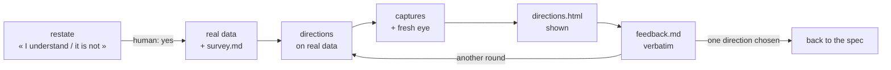

# Lead UX: usage before technique, and a push only after the local gates

**Status:** draft — waits on the Owner's reading of spec and plan; no code before

---

> 🧑 **REVIEW CAREFULLY** — human decision surface. Read it all before code.

## Context

Three requests from the Owner, Pierrick, on 2026-11-20, in one task.

**Usage before technique.** Through Dédale (go, message
249521459734233088): the analyses start from usage — the
journey, the screens, the interface — before the technique, « et ça va dans
Chisel ». Today step 2 of `workflow.md` writes the spec from the task and
names its seams; nothing asks who does what, on which screen.

**A Lead UX skill, autonomous.** The same day a page coded straight from a
spec, with no research, was judged « hyper naïf comme regroupement, comme
façon de voir », « pas assez dense », « il n'y a pas d'effort en fait ».
The research that followed (three short rounds in 3 h 40, on the Olympe
project) was judged « very top » and ended on « Go ! ». Its report names
what made the difference: his words as they are in the brief, real data
from the first round, a survey written before drawing, directions that
really differ, named and shown side by side, short rounds, his feedback
written down verbatim between rounds, and an eye that is never the agent's
own. On how to cut it, Pierrick corrected the first proposal: « Chisel peut
pas avoir la step sans le skill, car Chisel doit fonctionner sans le
harness. » So the skill lives in Chisel and carries its own means. Asked
« la première étape de la skill Lead UX, qui vivra dans Chisel ? », he said
« ok. »

**Push after the local gates.** Through Apollon (message
249573268200865792): « Oui important point […] pour pas surcharger
inutilement la CI/CD ». An agent pushes only once the repo's gates pass
locally; CI confirms, it is not where errors are found.

**What it is not.** Not the human review after the code: that is the task
on hold `chisel-relecture-humaine`
(`project-management/tasks/20261119-1644-relecture-humaine.spec.md`), with
its proofs, videos and pages Chisel serves. This task is the upstream side,
before any code; "Where it touches relecture-humaine" below draws the line.
Not a Harness skill either: the Harness plugs onto the three deliverables
by their names, on its own side.

## Scope

**Included:**
- A new skill, `lead-ux`, in `socle/agents/skills/lead-ux/`: it runs a UX
  research in short rounds before any code, when a task touches what a
  person sees or does. It carries its own means: the brief of a UX
  researcher sub-agent, a capture script on Playwright, a directions page
  template, and the brief of a fresh sub-agent that looks at the captures.
- Its three deliverables, named and placed (below).
- `workflow.md`, step 2: usage first, and where `lead-ux` is called.
- `workflow.md`, "Where the work stops": the stop after each round.
- `workflow.md`, "Sub-agents": a brief for an analysis states usage first.
- `workflow.md`, "After the close": push only once the gates pass locally.
- `discipline.md`, the table of situations and skills: one row for
  `lead-ux`.
- The `.agents/` copy of each changed socle file, kept identical.
- One intention per change under `socle/`.

**Not Included:**
- The `research` and `prototype` skills: verbatim copies of
  mattpocock/skills, left untouched. `lead-ux` points to them.
- Anything of the Harness: `harness captures`, its skills on visual
  choices, visual checks and HTML pages. `lead-ux` neither calls nor names
  them.
- The human review, visual proof after the code, §J of `project.md`, the
  pages Chisel serves: all `chisel-relecture-humaine`.
- A served page that brings the human's answers back to the agent: the
  directions page is a static file; the answers come back through the
  conversation until relecture-humaine's questions page exists.

## The three deliverables

Their names are the contract the Harness plugs onto. They live in a folder
beside the spec, named like it, so they are archived with it:

```
<Tasks>/<task-id>/ux/
  survey.md                 the survey
  round-<n>/directions.html the directions page of round n
  round-<n>/feedback.md     the verbatim feedback of round n
  scripts/                  the generators and the capture runs
  data/                     the real data, out of git when personal
```

| Deliverable | What it holds | Written |
|---|---|---|
| **The survey** — `survey.md` | What the real data says (a table: what the data shows, what it changes); for an existing screen, the audit of its content block by block (what it shows, its source, the decision it serves, doubles, what serves nothing, missing actions, the real journey step by step); what other products do (a table: product, what we take, why) | Before any direction is drawn; completed between rounds |
| **The directions page** — `round-<n>/directions.html` | Two to six directions that really differ in structure, each named in two or three words (never a letter) with two lines — the idea, and what it sacrifices — side by side, on the same real data; a field under each for the human's own words and one for the whole page; a button that copies them | Each round |
| **The verbatim feedback** — `round-<n>/feedback.md` | The human's words, verbatim, each with the agent's reading beside it so the human can correct the reading; then what the next round changes | Between rounds, before the next one starts |

## The skill, in its steps



1. **Restate.** Five lines to the human: « I understand: … It is not: … ».
   No research before the yes. The human's words go into the spec's
   Context as they are, with a "What it is not".
2. **Real data and the survey.** The Architect hands the research to a
   UX researcher sub-agent, through the brief the skill keeps (below). The
   researcher gathers the real records the screen will show first, then
   prior art, and writes `survey.md` before anything is drawn.
3. **Directions.** Two to six, built by the same researcher. They differ
   in how they see the screen, on named axes — the grouping, the density,
   how the supporting content shows, how one acts — never in colour alone.
   They come from generators (one command rebuilds every page after a
   correction), on the real data. When the screen lives in a running app,
   the `prototype` skill's UI branch builds them on the real route.
4. **The eye.** The capture script takes each direction at phone and
   desktop width, light and dark, and reports in text what overflows,
   console errors and what sits below the fold. A fresh sub-agent, which
   never saw the session, looks at the images against a fixed checklist and
   returns defects with their position. The agent that builds never looks
   at a capture itself.
5. **Show, then write the feedback.** The directions page goes to the
   human; the round stops. The answer goes into `feedback.md`, verbatim.
6. **Next round or done.** Short rounds, each starting from the files, not
   from memory. A next round may merge what the human kept from several
   directions into two or three combinations, and says in one line on the
   page whatever the human did not understand last time. When the human
   settles on one direction, it goes into the spec (Context, Architecture),
   and the workflow resumes.

**The researcher's brief.** Pierrick rated the Olympe research 3/5 — the
start 1, the end 4 — and asked to keep the brief that launched the UX
expert, « à remonter pour le skill dédié »: its first round tried very
different ways and presented them well, and the second merged features
from several directions, which worked. The skill keeps that brief as a template
(`BRIEF.md`), in Chisel's words and with no one person's taste, in this
order:

1. **The human's intent**, quoted as said, the complaints included.
2. **What I understand**, then **what it is not**: the neighbouring
   screens it must not become.
3. **What you do — research, not code in the repo:**
   1. *The survey*: the kinds of products to look at, named — those that
      solve the same gesture, not the same domain — and what to note: what
      we take, and why.
   2. *The house references*: what the human already liked in this
      project, with paths, and the taste the project keeps.
   3. *The real data*: where to take real records, never invented ones;
      the data model, with leave to propose a change, said apart.
   4. *Directions really different*: how many, on which axes, each a
      self-contained page filled with the real data, at phone and desktop
      width.
   5. *The directions page*, with the idea and what it sacrifices under
      each.
4. **The project's rules** for mockups, when it keeps some.
5. **Where the files go** (`ux/`), and **done**: the directions page
   written and checked by the eye.
6. **Write the survey to its file before drawing**: a long session loses
   what is not on disk.

A next round's brief is short: the path of the feedback file, to be read
whole; the gist in three lines; what this round makes (the combinations,
the line for what was not understood).

## Decisions of 2026-11-21: what Apollon, Atlas and Olympe taught

On 2026-11-21 Pierrick asked whether this spec had caught up with the
work done with Apollon, Atlas and Olympe. A survey of those sources found
the generic rules below; each lands in the skill where named. Sources are
in the vault, abbreviated: **LUX** = `23.15 Olympe/Lead UX, ce qu'on
apprend.md`; **ER** = `23.15 Olympe/artefacts/2026-11-20 - Études
refusées, analyse.md`; **RETRO** = `23.14 Atlas/artefacts/2026-11-19 -
Rétro méthode UI, ui-refresh.md`; **BV** and **BM** = Atlas's briefs
`2026-11-21 - voiture-ux.md` and `2026-11-20 - ui-refresh, retour aux
maquettes.md`; **J** = Atlas's journal, 2026-11-21, 13:15–14:03.

1. **The kinds of question are named from the first brief** — a quick
   choice, a visual comparison, free text — and the form of the page
   follows the kind (LUX §5.1: « c'est pas une question de taille, c'est
   une question de là où je suis »). *Lands in:* step 1's restatement and
   the researcher's brief, part 2.
2. **Everything at the keyboard, text fields included**: the directions
   page and every direction can be driven without a mouse (LUX §5.2, said
   from round 1). *Lands in:* the directions page template; the eye's
   checklist gains "a control unreachable at the keyboard", checked by
   the capture script's keyboard pass, not by the eye.
3. **Source captures in high definition**, from the survey on: a crop of
   a reduced capture stays unreadable on a phone (LUX §5.4). *Lands in:*
   the capture script takes captures at device scale factor 2.
4. **No page without a request.** Each page or screen a direction adds
   names the human's request it answers; one drawn from the agent's own
   inspiration is marked a proposal until the human says what it is for —
   the test: « qui l'a demandée, quel geste la suit » (LUX §3.4, ER §3.4).
   *Lands in:* step 3 and the directions page (a line per direction:
   "answers: …").
5. **Re-read what the human asked for or placed before removing, lightening
   or moving anything**; never "we change nothing" on a redesign
   (LUX §3.5, ER §3.5: « la plupart des infos montrées je les avais
   demandées. là j'ai l'impression qu'il n'y a plus rien »). *Lands in:*
   `survey.md` gains a section *Asked for or placed*, re-read for each
   direction; the eye's brief does not check it, the researcher does.
6. **"What is already good and must not move" is asked early, with the
   visuals in front of the human** (RETRO, « Ce que je referais » 2;
   J 13:40: asked without the captures, the human could not answer).
   *Lands in:* step 1 for an existing screen, asked on the state-of-the-
   place page (decision 7); the answer goes into `survey.md`, *To keep*.
7. **The state of the place is shown as a page** for an existing screen:
   captures of the screen as it is, the audit in tables, the usage
   problems ranked (blocking, major, minor), what to keep — before any
   direction (RETRO « Le cadrage »; LUX §1 and §2: « montrer l'audit
   seul, puis les variantes partant de la vraie page »; J 13:40). *Lands
   in:* round 0 — `round-0/directions.html` with a single column (the
   screen as it is, its audit tables, the *To keep* question), its answer
   in `round-0/feedback.md`; the three deliverable names stay the
   contract (Q5, settled by the launcher 2026-11-21: a deliverable name,
   not a matter of taste).
8. **The scope is asked before drawing** — which screens: these, the
   flow, the whole section (J 13:42–14:03). *Lands in:* step 1.
9. **The screen as it is stays beside the directions**, as their
   reference, in every round of a redesign (RETRO: « 2 versions live
   (nouvelle et ancienne) afin de vraiment pouvoir comparer »). *Lands
   in:* the directions page's first column, "As it is". Live old-and-new
   during the code is relecture-humaine's (table below).
10. **The chosen direction is the thread to the code**: the spec cites it
    by path (`round-<n>/directions.html`, the direction's name, its
    captures in `round-<n>/captures/`), the plan cites it, the Typist
    follows it; where it contradicts a written decision, the agent asks
    instead of choosing (BV step 3, BM: « mes briefs ne citaient pas les
    maquettes […] il faut suivre le dessin »). *Lands in:* step 6 and the
    "Sub-agents" line of `workflow.md` (a brief for a screen cites its
    chosen direction).
11. **Small rules carried with them**: real data comes from a demo or an
    anonymised copy, never written to production (BV); a quote attributed
    to the human is checked at its source (LUX §2); the page says what it
    shows and what it does not show yet (RETRO 3); the blocking questions
    come first, with a direct link (RETRO 4); research and drawing run in
    separate sessions when the context grows (LUX §2). *Lands in:* steps
    2, 5 and the researcher's brief.

Kept out, as one person's taste: the densest variant, no explanatory text
in a mockup, a click rather than a form, the widths 1440/390, the model
choice. The project's own taste notes carry those.

## Where it lands in `workflow.md`

- **Step 2**, after the task is read and before the seams: when the task
  touches what a person sees or does, the analysis starts from usage — the
  journey, the screens, the interface — before the technique. A new screen,
  a new flow or a redesign runs `lead-ux` before the spec leaves `draft`;
  a smaller change to a screen writes its journey in the spec and goes on.
- **Where the work stops**: Architect → Human, after each round of
  `lead-ux`.
- **Sub-agents**: a brief for an analysis states the usage first — who
  does what, on which screen — then the code that serves it; a brief for
  a screen that went through `lead-ux` cites its chosen direction by path.
- **After the close**, before opening the pull request: push only once the
  gates of `.agents/project.md` pass locally; CI confirms, it does not
  discover.

## Where it touches relecture-humaine

| Point | `lead-ux` (this task) | `chisel-relecture-humaine` (on hold) |
|---|---|---|
| When | Step 2, before any code | After the close, on the pull request |
| Captures | Its own Playwright script, for the directions | `visual-proof`, from the commands of a future §J. `SKILL.md` says now, generically, that a screenshot command declared in `.agents/project.md` replaces the script (Q4, Owner 2026-11-21), so §J plugs in without touching `lead-ux`; the "before" captures of a survey can serve as the "before" of the proof |
| A page for the human | The directions page: a static file; answers come back through the conversation into `feedback.md` | The questions page Chisel serves, which brings answers back (its decisions 6 and 16). When it exists, the directions page becomes one of its pages; the three file names stay |
| Autoroute | A task that runs `lead-ux` is not small: it stops for the human each round | The autoroute (its decision 14) skips the human's stops |
| Old and new side by side | During the research: the screen as it is, captured, in the first column of every directions page (decision 9) | During the code: the live comparison, `main` beside the branch on demo data — part of the proof after the code (its slice 4) |
| The delivered screen against the chosen direction | Leaves the reference: the chosen direction and its captures, cited by path in the spec (decision 10) | The comparison itself, captures side by side before the human's review (its slice 4) — unless Q6 puts a stopgap line in the Mason's close now |
| Its decision 15 | — | « se concentrer sur la UX : à quoi on veut que ça ressemble » before the tool: a natural first use of `lead-ux` |

Nothing of this task edits relecture-humaine's files.

## Acceptance Criteria

- [ ] **skill-ships** — `socle/agents/skills/lead-ux/SKILL.md` exists,
  model-invoked (no `disable-model-invocation`), and every file of the
  skill is listed in `src/socle-files.ts`.
- [ ] **three-deliverables-named** — `SKILL.md` names *the survey*, *the
  directions page* and *the verbatim feedback*, with the paths of "The
  three deliverables" above.
- [ ] **researcher-brief-kept** — `socle/agents/skills/lead-ux/BRIEF.md`
  holds the researcher's brief in the six parts of "The researcher's
  brief", and the round-two brief; `SKILL.md` sends the Architect to it at
  steps 2 and 6.
- [ ] **screenshot-hook** — `SKILL.md` says a screenshot command declared
  in `.agents/project.md` replaces the capture script, with no section
  number.
- [ ] **lessons-of-21-11-carried** — each of the eleven decisions of
  2026-11-21 is found in the file its *Lands in* names; the work document
  ticks them one by one, with the line.
- [ ] **keyboard-pass-runs** — the capture-runs run also reports, on the
  filled template, the controls the Tab key never reaches (none expected).
- [ ] **no-harness** — `grep -riE
  "harness|herdr|choix-visuels|verification-visuelle|page-html"
  socle/agents/skills/lead-ux` finds nothing.
- [ ] **vendored-untouched** — `git diff origin/main --
  socle/agents/skills/research socle/agents/skills/prototype
  .agents/skills/research .agents/skills/prototype` is empty.
- [ ] **capture-runs** — the capture script, run on the directions template
  filled with two dummy directions, writes captures at 390 and 1280 px in
  light and dark and a text report; the run and its output are written in
  the work document.
- [ ] **usage-first-in-step-2** — step 2 of `socle/agents/workflow.md`
  states usage first and names `lead-ux`, with the line between a run of
  the skill and a journey written in the spec.
- [ ] **round-stop-listed** — "Where the work stops" lists the Architect's
  stop after each `lead-ux` round.
- [ ] **analysis-brief-usage-first** — "Sub-agents" of `workflow.md` says
  a brief for an analysis states usage first.
- [ ] **push-after-local-gates** — "After the close" of `workflow.md` says
  the push waits for the gates to pass locally.
- [ ] **discipline-row** — the table of situations and skills of
  `socle/agents/discipline.md` has a `lead-ux` row.
- [ ] **socle-copy-identical** — `diff -r .agents socle/agents` shows only
  what it showed on `origin/main`.
- [ ] **intentions-ship** — each change under `socle/` has its intention
  in `socle/intentions/unreleased/`, listed in `src/socle-files.ts`; the
  Intention gate passes.
- [ ] **writing-checked** — the skill and the changed prose went through
  `writing-great-skills`, and the work document says what it changed.
- [ ] **suite-green** — `deno task check` and `deno task test` pass.

## Seams

- `workflow.md` — an Architect following step 2 on a task that touches a
  screen starts from usage and runs `lead-ux` before the spec leaves
  `draft`; it stops after each round; it pushes after the local gates.
- `lead-ux` — an agent that runs it leaves the three deliverables at their
  paths; the Harness, or any other layer, finds them there by name.
- The capture script — given a URL or a file, it writes captures and a
  text report; it needs Playwright and nothing of the Harness.

## Architecture

**System design:** prose in the workflow and the discipline, one new skill
folder with four kinds of files (the steps in `SKILL.md`, the
researcher's brief, the capture script, the directions page template), two
intentions. The socle under
`socle/` is the source; `.agents/` is its identical copy. The skill writes
into the task workspace of `.agents/project.md` §A, beside the spec; it
reads nothing from outside the repo.

---

> 🧑 **REVIEW IF RELEVANT** — decisions, testing, slicing.

## Implementation Decisions

- **The name** is `lead-ux`, in Chisel's vocabulary: an activity the
  Architect runs at step 2, not a new role. The roles stay four.
- **The capture script is Deno TypeScript** (Q1, Owner 2026-11-21:
  « Deno »): Deno is the one thing Chisel requires. A repo whose own
  checker scans every `.ts` excludes `.agents/`; the script's header says
  so.
- **The screenshot hook is written now** (Q4, Owner 2026-11-21: « phrase
  maintenant »): one generic sentence in `SKILL.md`, no section number,
  nothing created in `project.md`.
- **The researcher is a sub-agent** at the Architect's tier: it earns its
  cost by keeping the research out of the Architect's context, and by
  carrying the brief the Owner asked to keep.
- **Tier**: the Architect runs it at its own tier; the eye is a sub-agent
  at *mid* (`.agents/reference.md`, "Model tiers"): it reads images and
  returns text, it decides nothing.
- **Real data out of git when personal.** A record that names a person or
  holds a client's data stays in `ux/data/` ignored by git; what is
  committed is anonymised.
- **Captures in git only when the directions page shows them**; the eye's
  captures stay out.
- **Generic taste.** The skill carries no one person's taste; it says to
  read the taste the project keeps, and the earlier feedback files.
  Pierrick's own (dense, direct, all at the keyboard) belongs to his
  projects and the Harness.
- **Sessions.** The files are the memory: a round restarts from the
  survey, the feedback and the generators. Research runs in a sub-agent so
  the Architect's context stays clean.
- **Intentions**: `lead-ux-before-screens`, `automatic` (the copy is the
  change); `push-after-local-gates`, `informational` (the human should
  know, the repo has nothing to edit).
- Prose for agents passes through `writing-great-skills`.

## Testing Strategy

- `test/integrity.test.ts` guards the listing of the new files.
- The intention tests guard the two intentions' format.
- The capture script is checked by a real run (criterion
  **capture-runs**), not by the suite: the suite has no browser.
- Prose is checked by greps and diffs (criteria above).

## Slices & Dependencies

- **Slices:** one pass.

## Deliverables

- [ ] The `lead-ux` skill and its files
- [ ] The workflow and discipline lines, and their `.agents/` copies
- [ ] The two intentions
- [ ] A pull request in conventional commits, opened by the Architect
  after the close

## References

- Vault, Olympe project, `artefacts/2026-11-20 - Recherche UX des
  questions, rapport.md` — the report: sections « Ce qu'il n'a pas aimé »
  and « Ce qui a marché », the source of every step above.
- Same folder, `2026-11-20 - Questions, directions/methode.md` — the
  crewmate's method narrative, with its proofs, its snags (ten compactions,
  defects only an eye saw) and ten proposals.
- Vault, Olympe project, `Lead UX, ce qu'on apprend.md` — the audit before
  structure (section 1) and the restate rule (section 3, rule 1).
- Vault, Harness, `secondmates/olympe/briefs/2026-11-20 - ux-questions.md`
  and `… - ux-questions, tour 2.md` — the UX expert's two briefs, the
  model of `BRIEF.md`; the Owner's rating, 3/5, relayed on 2026-11-21.
- `project-management/tasks/20261119-1644-relecture-humaine.spec.md` — the
  task on hold this one must not overlap.
- `socle/agents/skills/prototype/UI.md` — the UI branch `lead-ux` points to
  for directions inside a running app.

- The sources of the decisions of 2026-11-21, listed with that section.

## Notes

**Open questions of 2026-11-21**, recommended option first.

- **Q5 — settled 2026-11-21** (the launcher: a deliverable name, not a
  choice of taste): option (a), round 0. See decision 7.
- **Q6 — the delivered screen against the chosen direction, before
  "done".** (a) A stopgap line now in the Mason's close step of
  `workflow.md`: when the spec cites a chosen direction, the close captures
  the delivered screen with `lead-ux`'s script and has a fresh eye compare
  it to the direction's captures; relecture-humaine's visual proof
  replaces the means when it lands. The failure it prevents was costly
  (BM: « c'est plus du tout ce que tu as proposé »), and relecture-humaine
  is on hold. (b) Nothing here: the comparison waits for relecture-
  humaine's slice 4.
- **Q7 — how many rounds.** The sources set no bound. (a) None in the
  skill: the human ends the research by choosing a direction. (b) A
  number after which the Architect asks whether to go on.

## Retrospective

_At the close._
