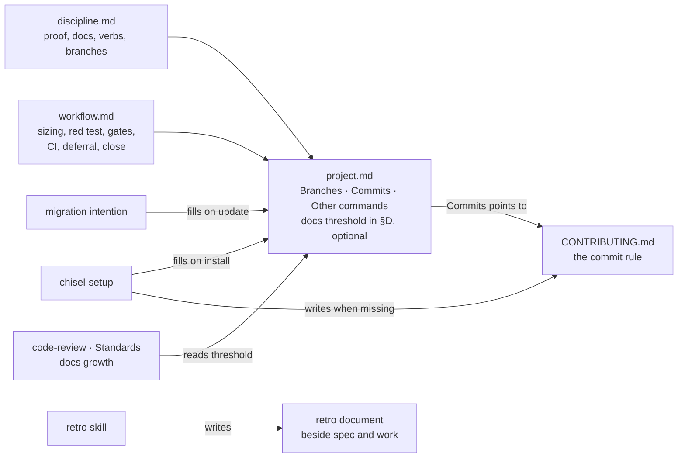

# Working rules from the field: branches, commits, gates, docs and the retro

**Status:** draft — the Owner answered on 22/11; waits on his approval of
this spec; no plan before

---

> 🧑 **REVIEW CAREFULLY** — human decision surface. Read it all before code.

## Context

From 9 to 21 November 2026, the Owner (Pierrick) and the projects that run
chisel asked, one by one, for working rules to move into chisel. The
toolkit maintainer gathered them in a table, each line with its words and
its source: the vault note « Chisel, règles de travail et crit »
(`23.17 Outillage/artefacts/2026-11-09`), section « Ce qui passerait dans
Chisel ». On 21/11 the Owner asked for the work to move on: « Continue à
avancer cette nuit en autonomie. »

Part of the table is already carried elsewhere: the human review and crit
by the task `relecture-humaine`, the rules every sub-agent brief carries by
pull request #7, the model named at launch by pull request #8. This spec
takes the rest, written so it holds for any team that uses chisel, not only
ours. "Where each line of the table goes" below says, line by line, what is
taken here, what is carried elsewhere, and what leaves.

## Scope

**Included:** the fifteen rules of "The rules" below, each in the file it
names, with:
- the `.agents/` copy of each changed socle file, kept identical;
- the new sections of `project.md.tpl`, this repo's `.agents/project.md`,
  and the `chisel-setup` steps that fill them;
- one intention per change under `socle/`.

**Not Included:**
- The human review, crit, the review synthesis, who fixes the comments, the
  one shot and the visual proof: `relecture-humaine`
  (`project-management/tasks/20261119-1644-relecture-humaine.spec.md`, on
  its own branch).
- What every sub-agent brief carries (long commands in the background, a git
  command that erases alone in its call, stop what you started): pull
  request #7. The model named at launch: pull request #8.
- Pushing only after the local gates: the task `lead-ux`, on its own
  branch.
- The `crit-review` script, which stays with the Harness (point 4 of the
  note), and anything that only holds for the Harness or our machines.
- Chisel for tasks without code (analysis, redesign, framing): a subject of
  its own, recorded in Notes, not treated here.

## The rules

Each rule is stated as chisel would carry it. The source is the Owner's
words with their date when the table has them; otherwise the line of the
table and who raised it.

1. **proof-before-cause** — before giving the human a cause, or asking them
   to act, cite in one line the proof read: the command and its message, the
   output, their words. Without proof, write "not verified"; when one read
   gives the proof, read first. *Where:* `discipline.md`, a rule beside
   "Read before acting". *Source:* Pierrick, 12/11: « Yes. C'est aussi
   qqchose à remonter dans Chisel ».
2. **readme-presents-and-points** — the README presents the repo and points
   to the docs. A feature adds a line and a link to it, never its reference
   doc, which goes in the living docs root. The Standards axis of
   `code-review` flags an existing doc that the diff grows beyond a
   threshold (decision `docs-growth-in-review`). *Where:* `discipline.md`
   for the rule; `code-review`, the Standards axis, for the check; §D ·
   Documentation reference of `project.md` when a project sets another
   threshold. *Source:* Pierrick, music-downloader review #42, 12/11: « un
   README qui grossit, qui grossit […] peut-être quelque chose à mettre
   dans Chisel »; the check, Pierrick, 22/11.
3. **agent-docs-say-what-and-why** — a doc an agent writes is concise: what
   and why, the overall architecture and the delicate points, diagrams
   welcome, never a text version of the code. *Where:* `discipline.md`,
   beside the README rule; the close step's promotion into the living docs
   points to it. *Source:* Pierrick, music-downloader review #73, comment
   c_42ebfa, 18/11, raised by Apollon. music-downloader's own line leaves
   its `AGENTS.md` once this ships.
4. **actions-carry-a-verb** — a command or a function that acts is named
   with a verb: `library retag-artists-from-tidal`, not `library artists`.
   *Where:* `discipline.md`, the writing rule "name things by their
   meaning", extended to the names in code. Not `codebase-design`, a
   verbatim fork, and chisel installs no coding standards of its own.
   *Source:* Pierrick, music-downloader review #42, 12/11: « artists n'est
   pas un verbe, ça ne veut rien dire ».
5. **a-branch-per-task** — each task works on its own branch, named and
   based as `project.md` says, in a worktree when `project.md` says so; in a
   fresh worktree the dependency install runs first, before any other
   command, and a dev stack started there picks free ports. *Where:*
   `discipline.md` for the rule; a new `project.md` section, Branches, for
   the settings. *Source:* Pierrick, 09/11: « c'est un peu devenu mon
   default, mais porté par Chisel plutôt » (the worktree); the install
   first, a retro he passed on the same day. Each project chooses, the
   worktree is the default (decision `branches-each-project-chooses`).
6. **an-agent-rebases-only-its-own-branch** — the agent may rebase its own
   branch on the main branch and push it with `--force-with-lease`, never
   a branch that is not its own: another session's, a parent pull
   request's branch others build on, or the main branch. The forced push
   runs alone in its call, as pull request #7 says of every git command
   that can erase. It needs `origin/HEAD` set, which `chisel-setup` does.
   *Where:* the same `discipline.md` rule, and the
   Branches section, which may forbid it for a project. *Source:*
   Pierrick, 22/11: « Un agent qui rebase sa branche sur main doit force
   push, il en a le droit sur sa branche » (decision `rebase-own-branch`).
   It reverses the table's line `rebase-demande-push-force-interdit`,
   09/11.
7. **the-commit-rule-is-in-the-glue** — the repo's commit rule (the
   format, the accepted scopes, the scope for the task files, the body's
   line length) is written in the repo's `CONTRIBUTING.md`, where a human
   contributor looks too. When the repo has no `CONTRIBUTING.md`,
   `chisel-setup` writes one, with a single section, Commits, filled from
   the repo's commit linter or, without one, from what its history shows;
   when it has one without a commit rule, it adds that section; the
   migration intention does the same for an equipped repo. The file is
   then the repo's own: `update` never touches it. `project.md` only
   points to it, and the briefs read the rule there instead of saying "the
   commit rule" with no place to read it. *Where:* `CONTRIBUTING.md`, from a
   new template `socle/templates/CONTRIBUTING.md.tpl`; a new `project.md`
   section, Commits, one pointer line; `chisel-setup`, exploration and
   writes; the Mason and Typist briefs. *Source:* Olympe, 17/11, a spec
   commit refused for its scope; Pierrick, 23/11, in review: « Je préfère
   un CONTRIBUTING.md écrit par Chisel si il n'y en a pas ».
8. **the-commands-are-in-the-glue** — `project.md` names the commands a
   sub-agent needs beyond the gates: regenerate a generated client, create a
   migration, start and stop the dev stack. `chisel-setup` looks for them as
   it looks for the gates. *Where:* a new `project.md` section, Other
   commands; `chisel-setup`, step 1. *Source:* a Mason's retro, passed on by
   Pierrick on 09/11: each sub-agent looked for them alone.
9. **the-typist-sees-red-first** — the Typist writes the test, runs it and
   sees it fail before writing the code. *Where:* "The Typist brief" of
   `workflow.md`. *Source:* the same retro, 09/11.
10. **small-feedback-is-one-pass** — the sizing check first asks "one
    pass?". A list of small feedback is one task, one pull request, one
    commit per item. Only what is delicate, long, deep or complex is cut
    apart. A task is sized in agent time: a small feedback item is minutes,
    not a slice. *Where:* step 2 of `workflow.md`; `slice-task`, one line:
    never slice a list of small feedback. *Source:* Pierrick, 13/11: « une
    bonne partie sont à faire faire 1 PR. On ne sépare que les gros
    chantiers qui nécessitent des changements délicats, longs, profonds,
    complexes » ; « 1 commit par truc » ; « pourquoi j'ai autant de review
    à faire ?! ».
11. **the-full-suite-runs-once** — the fast checks (type check, lint) run at
    each change, the tests of what changed at each green step, the full
    suite once, before the review is proposed. *Where:* steps 5 to 7 of
    `workflow.md`. *Source:* Pierrick, 09/11: « pas tout relancer à chaque
    modification de code ».
12. **ci-is-read-by-its-verdict** — waiting on CI reads only the final
    state and the logs of the failing jobs, never the whole stream. How to
    wait is pull request #7's rule. *Where:* "After the close" of
    `workflow.md`. *Source:* the table's line `gh-pr-checks-watch-verbeux`,
    raised by Dédale, 09/11. Its other half, « au premier plan », was
    reversed by the Owner's go of 17/11: long waits run in the background.
13. **a-deferral-has-a-home** — a "later" leaves a review or a report as a
    task in the tracker, status `deferred` or `draft`, written by the role
    that defers, when it defers. The close checks that no "later" stays
    orphaned in the Notes of the spec or the work document. *Where:*
    "Blockers and questions" and the close step of `workflow.md`. *Source:*
    raised by Apollon for Pierrick, 11/11: on music-downloader #33 a
    deferral stayed in the spec's Notes and was archived with the task.
14. **the-retro-is-written-down** — the retro writes its proposals in a
    third document beside the spec and the work document,
    `<time-id>-<intention>.retro.md`, not only in the close report; the
    close archives the three together. A slice's retro sits beside the
    slice it closes. The spec template loses its Retrospective section. A
    proposal that targets chisel's socle (`.agents/`, its skills) names
    chisel's maintainers as its owner: `update` overwrites a local edit
    there. *Where:* `retro`, steps 4 and 5; the close step of
    `workflow.md`; `socle/templates/000-template.spec.md` (the section and
    its two mentions in the zone tables); `reference.md`, the Task and Spec
    document entries and a new Retro document entry. *Source:* Pierrick,
    18/11: « si on ne les utilise pas on s'en sortira pas »; 23/11, in
    review, on where it goes: « a coté du spec et work ? ».
15. **skills-go-through-the-writing-guide** — the agent that writes or
    edits a skill goes through the skill-writing guide chisel ships before
    its commit; the Standards axis of `code-review` checks that a skill
    the diff touches follows it. *Where:* step 5 of `workflow.md` and the
    Typist brief; `code-review`, the Standards axis. *Source:* Pierrick,
    22/11, to « toute skill écrite ou modifiée passe-t-elle par
    writing-for-agents ? »: « Règle du workflow ». In chisel pull request
    #9, skills written without it had weakened a guard rule, and only the
    code review saw it.

## Where each line of the table goes

| Line of the table | Goes to |
|---|---|
| `rebase-demande-push-force-interdit` | rule `an-agent-rebases-only-its-own-branch`, which reverses it (Pierrick, 22/11) |
| `gh-pr-checks-watch-verbeux` | the wait: pull request #7 (and reversed on 17/11); the reading: rule `ci-is-read-by-its-verdict` |
| `crit-review-fichiers-au-lieu-du-diff` | `relecture-humaine`, decision 7: the review reads the pull request's diff (`crit --pr`). Not written there: the base of a branch diff without a remote, which must be the pull request's base, not `main`. The « commande » is the Harness's `crit-review` script |
| `crit-client-expire-24h-daemon-parasite` | fixed in the Harness's script. The rule chisel keeps (an expired wait is not a blocker) is not written in `relecture-humaine`; it belongs to its review skills, decision 8, open |
| the branch rules | rule `a-branch-per-task` |
| `chisel-gates-avant-revue` | rule `the-full-suite-runs-once`; `lead-ux` adds the push after the local gates |
| the commands of a sub-agent | rule `the-commands-are-in-the-glue` |
| the Typist brief | rule `the-typist-sees-red-first`; the commit rule with its limits by rule `the-commit-rule-is-in-the-glue` |
| the deferrals | rule `a-deferral-has-a-home` |
| `preuve-avant-diagnostic` | rule `proof-before-cause` |
| `readme-qui-grossit` | rule `readme-presents-and-points` |
| `petits-retours-une-pr` | one human review per pull request: `relecture-humaine`, decision 7. The rest: rule `small-feedback-is-one-pass` |
| `pas-de-question-dans-crit` | `relecture-humaine`, decision 4, and its questions page (slice 5) |
| `nom-de-commande-verbe` | rule `actions-carry-a-verb` |
| `regle-de-commit` | rule `the-commit-rule-is-in-the-glue` |
| `doc-des-agents` | rule `agent-docs-say-what-and-why` |
| `retro-qui-reste` | rule `the-retro-is-written-down`. Leaves: routing a proposal to the right secondmate, a Harness matter, already in its secondmate role |
| the story's first chapter (17/11), and the note's question 3 (story order) | `relecture-humaine`, decisions 21 and 22: the strategic reading first, then the proofs, then the guide, core first |
| the note's proposals 1, 2, 3, 5 and question 2 (crit for every project) | `relecture-humaine`, decisions 1, 2, 3, 7 and 8 |
| the note's point 4 and question 4 (`crit-review.sh`) | the Harness |
| the note's question 5 (one task?) | its two other parts are done: the Typist types by default since 0.3.0 (journal 50), and the resume after the review is `relecture-humaine`, decision 11. What is left was decided on 21/11: one task, one pull request, one commit per rule |
| the note's question 6 (chisel as our default outside a repo) | Notes, out of scope |
| not in the table: Pierrick's answer of 22/11 on skills and `writing-for-agents` | rule `skills-go-through-the-writing-guide` |

## Acceptance Criteria

- [ ] **each-rule-in-its-file** — each of the fifteen rules is found, in
  substance, in the file "The rules" names for it.
- [ ] **copies-identical** — each changed file under `socle/agents/` is
  byte-identical to its `.agents/` copy.
- [ ] **glue-sections** — `socle/agents/project.md.tpl` and this repo's
  `.agents/project.md` have the Branches, Commits and Other commands
  sections; Branches says worktree by default; Commits points to
  `CONTRIBUTING.md`.
- [ ] **setup-fills-them** — `chisel-setup` explores the commit linter and
  the extra commands, writes the commit rule into `CONTRIBUTING.md` (the
  whole file when the repo has none), and asks the worktree question of decision
  `branches-each-project-chooses`, and sets `origin/HEAD` when it is
  missing.
- [ ] **docs-growth-flagged** — the Standards axis of `code-review` flags,
  as a judgement call, an existing doc the diff grows beyond the threshold
  of decision `docs-growth-in-review`, read from §D when a project sets
  one.
- [ ] **close-checks** — the close step of `workflow.md` checks the orphan
  "later", writes the retro document beside the spec and the work
  document, and archives the three together; the spec template has no
  Retrospective section left.
- [ ] **no-harness-word** — no changed socle file names the Harness, crit's
  script, a secondmate, a machine of ours or one of our projects.
- [ ] **forks-recorded** — each edit to a vendored skill (`retro`,
  `slice-task`, `code-review`) is added to its `x-upstream` `changes` line.
- [ ] **intention-per-change** — every change under `socle/` has its
  intention in `socle/intentions/unreleased/`, listed in
  `src/socle-files.ts`; the glue sections come with a migration intention,
  since `update` never touches `project.md`.
- [ ] **suite-green** — `deno task check` and `deno task test` pass.

## Seams

- Seam: `discipline.md` — any session, with or without a task, follows the
  ambient rules (proof, docs, names, branches).
- Seam: `workflow.md` — an agent running a task meets the sizing check, the
  Typist's red test, the gate cadence, the CI reading, the deferral and the
  close checks where the steps put them.
- Seam: `project.md` — the Branches, Commits and Other commands sections are
  the only place the socle reads these settings from; nothing in the socle
  hardcodes a branch name, a commit scope or a command.

## Architecture

**System design:** prose only, no CLI change. The ambient rules go to
`discipline.md`, the step rules to `workflow.md` and two skills, the
project's settings to `project.md`, which `chisel-setup` fills on install
and a migration intention fills on update.

---

> 🧑 **REVIEW IF RELEVANT** — decisions, testing, slicing.

## The Owner's answers (22/11)

Given on Olympe's questions page, 22/11, passed on by the toolkit
maintainer.

- **branches-each-project-chooses** — his words: « Chaque projet choisit »,
  and in a note: « Worktree comme default. P-e demandé lors de
  l'install ? ». Each project writes its choice in the Branches section of
  `project.md`; the template's default is a worktree per task, in
  `.worktrees/<branch>`. `chisel-setup` asks it at install (Pierrick,
  22/11, to « P-e demandé lors de l'install ? »: « La poser »), in step 2,
  after §I, verbatim like §B and §I:
  > **Should each task work in its own worktree?**
  > 1. **Yes, in `.worktrees/<branch>`** — several sessions can work on the
  >    repo at once without touching each other's files.
  > 2. **No, a branch in the main checkout** — one session at a time.
  >
  > Recommended: **1 — a worktree per task.**

  The branch name, its base and the cleanup are stated, not asked: the
  task's slug, from the freshly fetched main branch (the parent's branch
  when stacked), the worktree removed by the agent once merged. An
  existing `.worktrees/` folder or a team habit found in step 1 is stated
  as the answer, not asked again.

  At the same step, when `origin/HEAD` is missing (`git symbolic-ref
  refs/remotes/origin/HEAD` fails), `chisel-setup` runs `git remote
  set-head origin -a` and says so; the migration intention does the same
  for an already equipped repo. It writes only a local ref and is
  harmless. With it, every tool knows the repo's default branch, and a
  guard that only allows `--force-with-lease` off the default branch can
  tell which branch that is. *Source:* a prerequisite passed on by the
  toolkit maintainer, 22/11: the guard of our agent setup refuses the
  forced push when it cannot resolve the default branch.
- **rebase-own-branch** — his words: « Un agent qui rebase sa branche sur
  main doit force push, il en a le droit sur sa branche ». It becomes rule
  `an-agent-rebases-only-its-own-branch`, with `--force-with-lease` so a
  push someone else made in between is never lost. Checked against this
  spec and `.agents/workflow.md`, `.agents/discipline.md`: nothing else
  forbids a forced push; discipline's "never force" (rule on formality) is
  about passages, not git.
- **docs-growth-in-review** — his words: « Je pense qu'il faut un role
  "gardien" qui tourne régulièrement. Mais ça fait tres meta harness. P-e
  sinon rajouter ça à l'axe de review ? Avec un % d'augmentation des docs
  existants. » The simpler road is taken: a criterion of the Standards axis
  of `code-review`. A doc that existed before the diff (the README, a page
  of the living docs root) and grows by more than **10 %** is flagged as a
  judgement call, never a hard violation; no floor in characters.
  Pierrick, 22/11, on the threshold: « +10 % ». The reason: a feature that
  follows rule `readme-presents-and-points` adds a line and a link, a few
  percent; beyond a tenth, a reference section is likely moving in. The
  threshold stays adjustable per project, in §D. It replaces the README size ceiling first
  proposed: no ceiling, no gate. The periodic "guardian" role leaves
  scope (Notes).

## Implementation Decisions

- The new `project.md` sections take the letters after §J, which
  `relecture-humaine` reserves for Review: K · Branches, L · Commits,
  M · Other commands, unless an earlier merge takes a letter first.
- The commit rule lives once, in `CONTRIBUTING.md`; §L · Commits is one
  line that names that file and its section. A repo whose commit rule
  lives elsewhere (a docs page) says so in that line, and `chisel-setup`
  writes no `CONTRIBUTING.md` then. This repo's own `CONTRIBUTING.md`
  already has the section.
- The end-to-end test command lives once: in §J of `relecture-humaine` when
  it lands, which "Other commands" then points to; in "Other commands"
  until then.
- The skill-writing guide chisel ships is `writing-great-skills`, the
  upstream skill now named `writing-for-agents`, vendored under its former
  name (see `retro`, step 1). The rule names the shipped skill. It is
  user-invoked (`disable-model-invocation`): the rule says to read its
  `SKILL.md`, which works whether or not the Skill tool may call it.
- Runtime tools are named as examples only, as pull request #7 does.
- Content written for agents goes through `writing-for-agents`
  (`CONTRIBUTING.md`).

## Testing Strategy

- `test/integrity.test.ts` catches a new socle file not listed.
- A test renders `project.md.tpl` placement on an empty folder and finds the
  three new sections.
- A grep test for `no-harness-word` over the changed socle files.

## Slices & Dependencies

One task, one pull request, one commit per rule (decided 21/11). The
slices below are reading chapters inside that pull request, in commit
order, not separate pull requests: the task applies its own rule
`small-feedback-is-one-pass`. No slice files.

1. **Ambient rules** (blocked by: none) — rules `proof-before-cause`,
   `readme-presents-and-points`, `agent-docs-say-what-and-why`,
   `actions-carry-a-verb`, and the docs growth criterion in `code-review`
   with its optional threshold line in §D.
2. **The glue: branches, commits, commands** (blocked by: none) —
   rules `a-branch-per-task`,
   `an-agent-rebases-only-its-own-branch`, `the-commit-rule-is-in-the-glue`,
   `the-commands-are-in-the-glue`; the three sections, the
   `CONTRIBUTING.md` template, `chisel-setup`, the migration intention.
3. **The workflow steps** (blocked by: 2, and pull requests #7, #8 and
   `lead-ux` merged, which edit the same paragraphs of `workflow.md`) —
   rules `the-typist-sees-red-first`, `small-feedback-is-one-pass`,
   `the-full-suite-runs-once`, `ci-is-read-by-its-verdict`,
   `a-deferral-has-a-home`, `skills-go-through-the-writing-guide` (with
   its `code-review` criterion), and the close checks.
4. **The retro written down** (blocked by: none) — rule
   `the-retro-is-written-down`, with the spec template and `reference.md`.

Chapters 1, 2 and 4 can be typed before #7, #8 and `lead-ux` merge;
chapter 3 waits for them, and the pull request opens once it is done.

## Deliverables

- [ ] One pull request: one commit per rule, in chapter order, each with
  its intentions, and a passing gate.

## References

- Vault note « Chisel, règles de travail et crit » (`23.17 Outillage/
  artefacts/2026-11-09`): the table this spec takes, with each line's words
  and source.
- `project-management/tasks/20261119-1644-relecture-humaine.spec.md`, on
  branch `chisel-relecture-humaine`: the human review's decisions this spec
  leaves to it.
- Pull requests #7 (the rules every sub-agent brief carries) and #8 (the
  model named at launch).
- `project-management/tasks/20261120-2208-lead-ux.spec.md`, on branch
  `chisel-lead-ux`: the push after the local gates.

## Notes

- **Out of scope: a periodic "guardian" role** that watches the docs grow
  between tasks: Pierrick calls it « tres meta harness » (22/11); chisel
  takes one task and orchestrates nothing.
- **Out of scope: chisel for tasks without code.** Raised on 21/11 by the
  Owner through Dédale: Atlas lost decisions of his (the old expense
  classification, the screen decisions of 18/11) because its "meta" tasks
  (analysis, redesign, framing) run on a Harness brief and not through
  chisel, and nothing brought the spec up to date. His words: « tout ça
  c'est du Chisel […] Avoir Chisel un peu étendu peut-être pour ce genre
  de tâches-là, mais qui est utilisé par tous les dieux, ça nous ferait
  gagner du temps parce que là on maintient un peu deux trucs ». What I
  understand: chisel today takes a task "from intent to commit", and its
  spec is where a human's decisions are kept; a task with no code has no
  spec, so its decisions live in a brief or a chat and are lost at the next
  session. The question is whether chisel takes such tasks, with a spec and
  no Mason or Typist, for every project. `relecture-humaine` decision 6
  already leans that way (« C'est applicable aux agents non dev aussi »).
  It touches the charter's first line, so it is a task of its own, with the
  Owner.
- The base of a branch diff in a human review (the pull request's base, not
  `main`, on stacked pull requests) is not written in `relecture-humaine`:
  to pass to that task, whose spec this task does not touch.

## Retrospective

_At the close, in `20261122-0002-working-rules-from-the-field.retro.md`
beside this spec, as rule `the-retro-is-written-down` asks._
